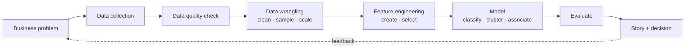
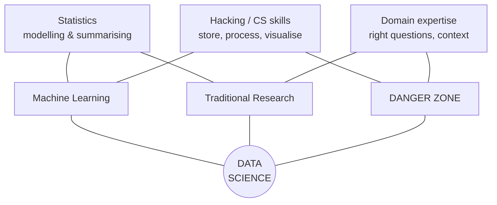
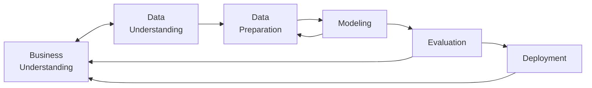
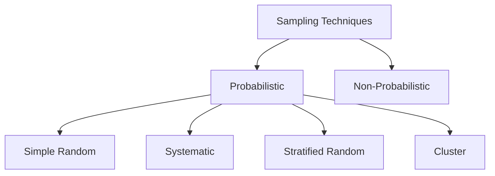
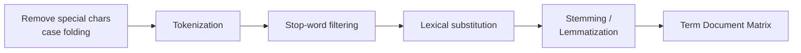
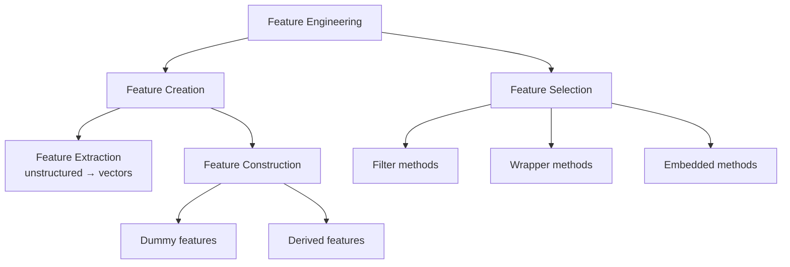

# Introduction to Data Science — Complete Study Notes

> **Course:** DSE ZG532 · BITS Pilani WILP
> **Built from:** all `Class Material` slide decks (Modules 1–7), `Handout.md`, assignment notebook, past Mid-Sem Q&A.
> **Companion file:** [IDS_Sample_Question_Set.md](IDS_Sample_Question_Set.md) — all practice questions with model answers.

---

## How To Use This File

- One file = every concept, formula and worked example from class.
- Every module ends with an **Exam Hooks** box: what gets asked, and how to answer.
- Formulas are in plain code blocks so they render everywhere.
- Worked examples reproduce the exact slide numbers used in class.

### Module Map

| # | Module | Slide deck | Exam weight |
|---|---|---|---|
| 1 | Fundamentals of Data Science | IDS_01 Part 1 & 2 | High (definitions, roles) |
| 2 | Data Analytics | IDS_2_Data_Analytics | High (4 analytics types, CRISP-DM) |
| 3 | Data and Data Models | IDS_3_Data | **Very high** (attribute types, quality) |
| 4 | Data Wrangling | IDS_4 + IDS_5 | **Very high** (stats, proximity, normalization) |
| 5 | Feature Engineering | IDS_6_Feature_Engineering | High (new features, filters) |
| 7 | Association Analysis | IDS_7_FP_growth | Medium (FP-tree, lift) |

### The One Diagram That Explains The Course



---

# Module 1 — Fundamentals of Data Science

## 1.1 What Data Science Is

- No single agreed definition exists; several are accepted in exams.
  - "Data science is the study of data."
  - "The art of uncovering useful patterns, connections, insights and trends hidden in data."
  - "Translating data into a story; the story uncovers insights that drive decisions."
- Inter-disciplinary practice drawing from:
  - data engineering, statistics, data mining, machine learning, predictive analytics.
- Most effort goes to **preparing, cleaning, scrubbing and standardizing** data.
- Process is **iterative**; automation frees time for *interpreting results*.

### Drew Conway's Venn Diagram (memorise this)



| Overlap | Meaning |
|---|---|
| Hacking + Statistics | Machine learning — models without domain meaning |
| Statistics + Domain | Traditional research |
| Hacking + Domain | **Danger zone** — can run a regression, cannot interpret it |
| All three | True data science |

- **Danger zone** = "knows enough to be dangerous"; source of "lies, damned lies and statistics".
- Sparsely populated, but a few people there can do a lot of damage.

### AI vs ML vs DS

| Term | One-line meaning |
|---|---|
| Artificial Intelligence | Machines mimic human cognitive behaviour (face recognition, self-driving) |
| Machine Learning | Sub-field / tool of AI; machines learn from experience (= **training data**) |
| Data Science | Applies ML, AI, statistics, visualisation and mathematics to real problems |

## 1.2 Data Science Process (Larose)


| Phase | What happens |
|---|---|
| Problem description | Clearly state objectives; frame a problem solvable with data science |
| Data preparation | Cleaning / preparation — the most labour-intensive phase |
| Exploratory data analysis | Gain insight through graphical exploration |
| Setup | Partition the data; balance it if classes are skewed; establish a baseline |
| Modeling | Apply algorithms to uncover hidden relationships |
| Evaluation | Decide whether models are any good; pick the best of the set |
| Deployment | Put the model to work on real-world problems |

- Compare with the **software engineering (waterfall)** process:
  - Requirements → Systems analysis → Design → Development → Testing.
  - Software engineering ends at *software deployment*; data science ends at *model deployment*.

| Data Science | Software Engineering |
|---|---|
| Collects and analyses data | Creates useful applications |
| Uses **ETL** process | Uses **SDLC** process |
| More process-oriented | Framework-driven (Waterfall, Agile, Spiral) |
| Tools: S3, MongoDB, Hadoop, MySQL | Tools: Rails, Django, Flask, Vue.js |
| Skills: ML, statistics, visualisation | Skills: coding languages |

## 1.3 Data Science Tasks (must-know table)

| Task | Predicts / finds | Typical algorithms | Example |
|---|---|---|---|
| **Classification** | Which predefined class a point belongs to | Decision tree, NN, Bayesian, rules, k-NN | Bucketing new customers into known segments |
| **Regression** | A numeric target value | Linear, logistic regression | Predicting next year's unemployment rate |
| **Anomaly detection** | Whether a point is an outlier | Distance-based, density-based (LOF) | Credit card fraud, network intrusion |
| **Association analysis** | Relationships inside an item set | FP-Growth, Apriori | Cross-selling from purchase history |
| **Time series forecasting** | Future value from history | Exponential smoothing, ARIMA, regression | Sales / production forecasting |
| **Clustering** | Natural groups without labels | k-Means, DBSCAN | Customer segmentation |
| **Recommendation** | Preference of an item for a user | Collaborative / content-based / hybrid | Top movie recommendations |

- **LOF** = Local Outlier Factor: unsupervised, compares a point's local density to its neighbours'.

## 1.4 Roles In A Data Science Team

| Role | Core responsibility |
|---|---|
| Data scientist | Designs modelling processes, builds predictive models, custom analysis |
| Data analyst | Manipulates large datasets, finds trends, informs business decisions |
| Data engineer | Cleans, aggregates, organises data from many sources into warehouses |
| Business intelligence specialist | Identifies trends in datasets, builds reports/dashboards |
| Data architect | Designs, creates and manages the organisation's data architecture |
| Data journalist | Puts model output in context; turns results into compelling stories |
| Chief analytics officer | Data science + programming + domain + leadership/vision |

- **"Data scientists are like unicorns"** — highly desirable but hard to find.
  - Needs Python/R + SQL/Excel + maths + visualisation + ML + domain experience.
  - Because one person rarely has all skills, organisations build **teams** instead.

### Typical data scientist workflow (11 steps)

1. Ask the right questions. 2. Acquire data. 3. Process and clean. 4. Integrate and store.
5. Initial investigation / EDA. 6. Choose candidate models. 7. Apply ML / statistics / AI.
8. Measure and improve. 9. Present to stakeholders. 10. Adjust on feedback. 11. Repeat.

## 1.5 Data Scientist's Toolbox

| Category | Tools |
|---|---|
| Languages | Python, R, Java, Scala, Clojure, Haskell |
| Big data | Hadoop, HDFS, MapReduce, Spark, Storm |
| Query on big data | Hive, Pig, Impala, Shark, HBase, Cascalog |
| Ingestion / ETL | Flume, Sqoop, web scrapers |
| Databases | SQL, RDBMS, DW, OLAP, NoSQL (MongoDB, Cassandra, Couchbase) |
| ML | scikit-learn, NumPy, SciPy, pandas, Weka, KNIME, RapidMiner |
| Visualisation | ggplot2, D3.js, Tableau, Gephi, Shiny |
| Statistics | SPSS, SAS, MATLAB |
| Everywhere | MS-Excel — most used, most underrated |

> ### 📌 Exam Hooks — Module 1
> - "Data Scientist vs Business Analyst" — answer with **focus**, **output**, **skills**, **time direction**.
> - "Describe a scenario where the data scientist is a bearer of bad news" — model contradicts management's belief.
> - Always name the **role first**, then list 4–5 responsibilities as bullets.

---

# Module 2 — Data Analytics

## 2.1 Definition

- Analytics = systematic computational analysis of data or statistics (Oxford).
- Data analysis = **cleaning, transforming and modelling data** to discover useful information for business decisions.
- Goals of analytics:
  - **Predict** something — fraud, rain, benign vs malignant tumour.
  - **Find patterns** — top 10 coldest days, most visited pages.
  - **Find relationships** — similar articles, similar patients, related products.

## 2.2 The Four Types Of Analytics ⭐ (highest-frequency exam topic)


| Type | Question answered | Techniques | Output example |
|---|---|---|---|
| **Descriptive** | What happened? | Descriptive statistics, histograms, correlation, visualisation, EDA | Dashboard: "Sales fell 12% last month" |
| **Diagnostic** | Why did it happen? | Pattern recognition, linear/logistic regression, neural nets, drill-down | "Delayed delivery caused most cancellations" |
| **Predictive** | What is likely to happen? | Regression, classification, SVM, deep learning | "Cancellations may reach 18% next month" |
| **Prescriptive** | What action should we take? | Optimisation, business rules, AI, simulation | "Add delivery partners in three cities" |
| **Cognitive** | What don't I know? | Semantics, NLP, deep learning, neural networks | Self-learning advisory system |

- Descriptive is also called **statistical analysis**; it uses raw data from multiple sources.
- Predictive accuracy depends on **data quality** and **stability of the situation**.
- Prescriptive needs historical internal data **plus** external trend information.
- Cognitive systems **reason like humans**, use probability, and **reprogram themselves**.
  - AI does something *for* you; a cognitive platform is something you *collaborate with*.

## 2.3 Methodologies

### Why a standard process?

- Framework for recording experience → projects can be replicated.
- Aids planning and management; "comfort factor" for new adopters.
- Reduces dependency on "star" individuals; encourages best practice.

### CRISP-DM — Cross Industry Standard Process for Data Mining



| Phase | Key tasks |
|---|---|
| Business understanding | Project objectives, requirements, data-mining problem definition |
| Data understanding | Initial collection, familiarisation, **identify quality issues**, first obvious results |
| Data preparation | Record and attribute selection, data cleansing |
| Modeling | Run the data mining tools / algorithms |
| Evaluation | Do results meet business objectives? Surface issues missed earlier |
| Deployment | Put models into practice; set up continuous mining |

- Conceived ~1996, **6 phases**, used in IBM SPSS Modeler, iterative.
- Chosen when the process must be **reliable, repeatable and flexible** across industries.

### SEMMA (SAS Institute) — 5 stages

| Stage | Meaning |
|---|---|
| **S**ample | Extract a portion big enough to be significant, small enough to handle (optional) |
| **E**xplore | Search for unanticipated trends and anomalies |
| **M**odify | Create, select, transform variables |
| **M**odel | Software searches for combinations that predict the outcome |
| **A**ssess | Evaluate usefulness and reliability of findings |

- Caveat to quote: *SEMMA is not a full methodology* — it organises the SAS Enterprise Miner toolset and focuses on **model development**.

### SMAM — Standard Methodology for Analytics Models

| Phase | Description |
|---|---|
| Use-case identification | Pick the ideal approach from candidates |
| Model requirements gathering | Conditions needed for the model to function |
| Data preparation | Getting data ready for modelling |
| Modeling experiments | Scientific experimentation on the business question |
| Insight creation | Visualisation and dashboards |
| Proof of value (ROI) | Small-scale run to prove value |
| Operationalization | Embed the model in operational systems |
| Model life-cycle | Governance of model lifetime and refresh |

### Big Data Life-Cycle — 12 phases

| # | Phase | # | Phase |
|---|---|---|---|
| 1 | Foundations | 7 | Storage |
| 2 | Acquisition | 8 | Integration |
| 3 | Preparation | 9 | Analytics and visualisation |
| 4 | Input and access | 10 | Consumption |
| 5 | Processing | 11 | Retention, backup, archival |
| 6 | Output and interpretation | 12 | Destruction |

- Four pillars: **Data Acquisition, Data Awareness, Data Analytics, Data Governance**.
- Processing includes annotation, integration, representation, aggregation.
- Output/interpretation is also called **data ingestion** (Sqoop, Flume, Spark Streaming).
- Phase 12 exists because regulation may **require** destruction after a period.

### The 10 questions a data science methodology answers

| Stage | Questions |
|---|---|
| Problem to approach | 1. What problem are you solving? 2. How can data answer it? |
| Working with data | 3. What data is needed? 4. Where does it come from / how to acquire? 5. Is it representative? 6. What manipulation is required? |
| Delivering the answer | 7. How to visualise? 8. Does the model answer the question? 9. Can you put it into practice? 10. Can you get constructive feedback? |

> ### 📌 Exam Hooks — Module 2
> - Classify statements into the four analytics types **and explain the progression** (what → why → what next → what to do).
> - "Recommend a methodology and justify" → CRISP-DM, because iterative, industry-standard, handles quality issues early.
> - Business Intelligence vs Data Science: BI = descriptive, backward-looking, reports/charts; DS = predictive/prescriptive, forward-looking, models and stories.

---

# Module 3 — Data and Data Models

## 3.1 Data, Objects, Attributes

- **Data** = a collection of data objects and their attributes.
- **Attribute** = property or characteristic of an object (eye colour, temperature).
  - Also called: variable, field, characteristic, **feature**.
- **Object** = collection of attributes.
  - Also called: record, point, case, sample, entity, instance.
- Values may carry properties the attribute itself does not have.
  - Average *age* is meaningful; average *employee ID* is meaningless.

## 3.2 Attribute Types ⭐⭐ (asked almost every exam)

| Property | Symbol test |
|---|---|
| Distinctiveness | `=` , `≠` |
| Order | `<` , `>` , `≤` , `≥` |
| Addition | `+` , `−` |
| Multiplication | `×` , `÷` |

Each type inherits all properties of the types above it.

| Type | Category | Permitted operations | True zero? | Examples |
|---|---|---|---|---|
| **Nominal** | Categorical | `=` `≠` only | n/a | ID numbers, eye colour, zip code, gender, city |
| **Ordinal** | Categorical | `=` `≠` `<` `>` | n/a | Grades, shirt size, satisfaction level, ranks |
| **Interval** | Numerical | `=` `≠` `<` `>` `+` `−` | **No** (zero is arbitrary) | Calendar dates, temperature in °C/°F |
| **Ratio** | Numerical | all, including `×` `÷` | **Yes** | Length, time, counts, age, height, income |

**Answer template for classification questions:**
> `Attribute` → **Type**, because the only meaningful operations are …, and zero does / does not mean absence.

### Classification by number of values

| Class | Definition | Examples |
|---|---|---|
| **Discrete** | Finite or countably infinite value set; usually integers | Zip codes, counts, words in documents; binary is a special case |
| **Continuous** | Real-numbered values; stored as floating point | Temperature, height, weight |
| **Asymmetric** | Only the **presence** (non-zero) matters | Course-taken flags; asymmetric binary attributes |

### Worked example (slides 14–17)

| ID | Age | Gender | Course ID | Percentage | Grade |
|---|---|---|---|---|---|
| 19001 | 24 | Female | CS 104 | 74 | Good |
| 19002 | 23 | Male | CS 102 | 75 | Good |
| 19003 | 25 | Female | CS 103 | 67 | Fair |

| | ID | Age | Gender | Course ID | Percentage | Grade |
|---|---|---|---|---|---|---|
| **Scale** | Nominal | Ratio | Nominal | Nominal | Ratio | Ordinal |
| **Values** | Discrete | Continuous | Discrete | Discrete | Continuous | Discrete |

## 3.3 Types Of Datasets

| Type | Definition | Examples |
|---|---|---|
| **Structured** | Defined data type, format and structure | Transactions, OLAP cubes, RDBMS, CSV, spreadsheets |
| **Semi-structured** | Textual file with a discernible, parseable pattern | XML, JSON, HTML page |
| **Quasi-structured** | Textual data with erratic format, formattable with effort | Web click-stream data |
| **Unstructured** | No inherent structure | Text documents, PDFs, images, video, email |

- **Public data** — collected/preprocessed for research and released (e.g. UCI repository).
- **Private data** — organisation-specific; IT Act 2000 and GDPR apply.

### Data by structure of records

| Form | Description |
|---|---|
| Record data | Flat file (CSV), RDBMS rows |
| Transaction data | Set of items per transaction — retail, banking, e-commerce |
| Data matrix | Record data with only numeric attributes |
| Sparse data matrix | Binary asymmetric 0/1 entries |
| Document-term matrix | Frequency of each term in each document |
| Sequential / temporal | Record data **plus** timestamps (money transfers) |
| Sequence data | Positions instead of timestamps (DNA bases G, T, A, C) |
| Time series | Temporal autocorrelation present |
| Graph data | Relationships among objects (web pages) or objects as graphs (molecules) |

### Media data

| Media | Dimensionality | Storage detail |
|---|---|---|
| Text | 1-D | Email body, PDF, Word document |
| Audio | 1-D time series | Speech, music |
| Image | 2-D in Euclidean space | Matrix of intensities `I(x, y)` |

- Black & white image → intensity 0 or 1.
- Greyscale → integer 0 (black) … 125 (grey) … 255 (white).
- Colour → 3 channels R, G, B, each 0–255.

## 3.4 Data Quality Issues ⭐⭐

| Issue | Meaning / cause |
|---|---|
| **Missing data** | Not recorded intentionally or otherwise; equipment failure, misunderstanding, judged unimportant |
| **Duplicate data** | Same record repeated |
| **Orphaned data** | Records whose parent/reference is missing |
| **Noise** | Random error or variance in a measured value |
| **Outliers / anomalies** | Objects whose behaviour differs greatly from expectation |
| **Inaccurate data** | Wrong attribute values: faulty instruments, human/computer entry errors, deliberate false values, transmission errors |
| **Inconsistent data** | Different naming conventions, codes, or formats (dates) |
| **Non-conformity** | Values outside the valid domain (Percentage = 175) |
| **Text encoding errors** | Corrupted characters |
| **Bias** | Data not representative of the population |

### Worked example (slides 38–39)

| Name | Age | Date of Birth | Course ID | Percentage |
|---|---|---|---|---|
| Amy | 24 | 01-Jan-1995 | CS 104 | 74 |
| Ben | 23 | Dec-01-1996 | CS 102 | 75 |
| Cathy | 25 | 01-Nov-1994 | *(missing)* | 67 |
| Diana | 24 | Oct-01-1995 | CS 104 | 79 |
| Ben | 23 | Dec-01-1996 | CS 102 | 75 |
| Eden | 24 | *(missing)* | CS 103 | **175** |
| Fischer | *(missing)* | 01-01-1959 | CS 105 | 70 |

- **Missing data** — Age, Date of Birth, Course ID.
- **Inconsistent data** — Date of Birth uses three different formats.
- **Duplicate data** — Ben appears twice.
- **Data conformity** — Percentage = 175 is impossible.

> **Noise vs error trap:** A tyre gauge that adds exactly **+3 psi to every reading** is a *systematic bias*, **not noise**. Noise must be **random** variance.

## 3.5 Formal Data Models

- A **model** is something we construct to help us understand the real world.
- Goal: a precise specification of the question and how data answers it.
- **Epicycle of analysis** — three repeating steps:

| Step | Action |
|---|---|
| 1. Setting expectations | Build a **primary model** = best current sense of the answer |
| 2. Collecting information | Build **secondary models** that challenge the primary model |
| 3. Revising expectations | If challenges succeed, adjust the primary model |

- A **statistic** is any summary of the data (mean, median, SD, max, min, range).
- A **statistical model** does two things:
  - gives a quantitative summary of data,
  - imposes a structure on the population the data was sampled from.
- A model mimics the **population** behaviour, realised through a **sample**, and allows randomness.

### Case study — willingness-to-pay survey (20 people)

```
25, 20, 15, 5, 30, 7, 5, 10, 12, 40, 30, 30, 10, 25, 10, 20, 10, 10, 25, 5
mean = $17.2      standard deviation = $10.39
```

| Step | Result |
|---|---|
| 1. Set expectations | Normal model → 68% pay between $6.81 and $27.59 |
| 2. Compare with reality | Histogram spikes at 10; Normal allows negative prices — impossible |
| 3. Refine | Switch to **Gamma** distribution (positive only) |
| Consequence | "Who pays ≥ $30?" Normal says 11%, Gamma says 7% |

- Options when model and data disagree: **get a different model, get different data, or do both**.
- **Benchmark model** = baseline against which better algorithms are measured.
  - Benchmarking needs experiments that are **comparable, measurable and reproducible**.

## 3.6 Analysis Types In Data Science

| Analysis | What it does | Output form |
|---|---|---|
| **Data characterization** | Summarises general features of one target class | Bar charts, curves, cubes, **characteristic rules** |
| **Data discrimination** | Compares target class against contrasting classes | **Discriminant rules** |
| **Association analysis** | Finds frequent itemsets, subsequences, substructures | Rules with support / confidence |
| **Classification** | Model that predicts categorical (discrete, unordered) labels | IF-THEN rules, decision tree, formula, neural net |
| **Regression** | Models continuous-valued functions; predicts numeric values | Fitted function / trend |
| **Cluster analysis** | Groups objects without labels | Clusters; maximise intra-class, minimise inter-class similarity |

- Classification and regression may need **relevance analysis** first, to find the attributes that matter.

## 3.7 Data Pipelines

- Pipelines move and transform data from sources to a destination where value is created.
- Steps: extraction → preprocessing → validation → (optionally model) → delivery.
- **Data engineers** build and maintain them.
- **Data ingestion** = extract from one source, load into another; the E and L of ETL/ELT.

| Step | ETL | ELT |
|---|---|---|
| E — extract | Gather from sources | Gather from sources |
| L — load | Load **fully transformed** data | Load **raw** data first |
| T — transform | Before loading | Inside the destination warehouse |

- **Orchestration** guarantees correct order and dependencies.
  - Pipelines are **DAGs** — Directed (path of execution) and Acyclic (no going back).
  - Tool: **Apache Airflow**.

### Storage destinations

| Store | Definition |
|---|---|
| **RDBMS** | Collection of named tables; attributes (columns) and tuples (rows), unique key |
| **Data warehouse** | Information from multiple sources, **unified schema**, usually one site, optimised for reporting |
| **Transactional DB** | One record per transaction: trans-ID plus list of items |
| **Data lake** | Stores high volume and variety **without** warehouse structure or query optimisation |

> ### 📌 Exam Hooks — Module 3
> - Attribute-type questions: always justify with permitted operations + true zero.
> - Quality-issue questions: name the issue, quote the offending cell, then give one fix.
> - "Is this noise?" → only if the error is **random**; constant offset = bias/systematic error.

---

# Module 4 — Data Wrangling

## 4.1 Measures Of Central Tendency

```
mean  x̄ = (x₁ + x₂ + … + x_N) / N
weighted mean x̄ = Σ wᵢxᵢ / Σ wᵢ
median  = middle value (N odd) | average of two middle values (N even)
mode    = most frequent value  (unimodal / bimodal / trimodal / multimodal)
midrange = (min + max) / 2
```

- Mean is **sensitive to outliers**; median is better for skewed data.
- Median is **expensive to compute** on very large datasets.
- Mode works for **both qualitative and quantitative** attributes.

### Skew relationship

```
mean − mode ≈ 3 (mean − median)
```

| Shape | Relationship |
|---|---|
| Symmetric unimodal | mean = median = mode |
| Positively (right) skewed | mode < median < mean |
| Negatively (left) skewed | mean < median < mode |

## 4.2 Measures Of Dispersion

```
range  = max − min
IQR    = Q3 − Q1
five-number summary = [ Minimum, Q1, Median, Q3, Maximum ]
outlier rule: value > Q3 + 1.5·IQR  or  value < Q1 − 1.5·IQR

variance σ² = (1/N) Σ (xᵢ − x̄)²  =  (1/N) Σ xᵢ²  −  x̄²
std dev   σ = √σ²
```

- Q1 = 25th percentile, Q3 = 75th percentile; quartiles show centre, spread and shape.
- The k-th q-quantile splits data so at most `k/q` lies below it; there are `q − 1` q-quantiles.
- σ = 0 only when all values are identical; otherwise σ > 0.
- Use σ **only** when the mean is the chosen measure of centre.

### Worked example (slides 9 & 19)

```
X = [30, 36, 47, 50, 52, 52, 56, 60, 63, 70, 70, 110]   (N = 12)

mean     = 696 / 12 = 58
median   = (52 + 56) / 2 = 54
mode     = 52 and 70   (bimodal)
midrange = (30 + 110) / 2 = 70

Q1 = 47 (3rd value)   Q2 = 52 (6th)   Q3 = 63 (9th)
IQR = 63 − 47 = 16
σ² = (1/12)(30² + 36² + … + 110²) − 58² ≈ 379.17
σ  = √379.17 ≈ 19.47
```

## 4.3 Data Cleansing

- Goal: remove errors so data truly and consistently represents its source process.

| Error family | Examples | Detection | Correction |
|---|---|---|---|
| Interpretation errors | Age < 100, height < 7 ft, price positive | Domain rules | IF-THEN-ELSE rules |
| Inconsistency between sources | "Female" vs "F", feet vs metre, dollars vs pounds | Frequency table | Standardise / map |
| Data-entry errors | Typos, lack of concentration, hardware failure | Frequency table | Assignment statements, rules |
| White-space and case | Trailing spaces, mixed case | String scan | Trim, lower-case |
| Impossible values | Negative price, age 250 | Range checks | Rules |
| Outliers | Extreme values | Box plot, scatter plot, min/max summary, 1.5 × IQR | Investigate, cap, remove |
| Code-book deviation | Data disagrees with documented encoding | Compare to code book | Correct the data |
| Different units | cm vs inch | Metadata check | Simple conversion |
| Different aggregation levels | Weekly vs work-week data | Metadata check | Summarise to common level |

- A **code book** describes the data: number of variables, number of observations, meaning of each encoding.

## 4.4 Handling Missing Values ⭐

| Method | Notes |
|---|---|
| **Ignore the tuple** | Used when the class label is missing; wasteful, poor when missing % varies |
| **Fill manually** | Time consuming; infeasible for large data |
| **Global constant** ("Unknown", −1) | Simple but not foolproof — mining may treat "Unknown" as a real concept |
| **Measure of central tendency** | Mean for symmetric distributions, **median for skewed** |
| **Class-conditional mean/median** | Mean income of customers in the *same credit-risk class*; median if skewed |
| **Most probable value** | Regression, Bayesian inference, decision-tree induction — **most popular** |

**Picking the imputation method (frequent exam sub-question):**

| Attribute type | Best imputation |
|---|---|
| Numeric, symmetric | Mean |
| Numeric, skewed / outliers present | Median |
| Categorical (nominal or ordinal) | Mode |

## 4.5 Noise And Smoothing

- **Noise** = random error or variance in a measured variable; outliers may represent noise.
- Smoothing techniques:
  - **Binning** — smoothing by bin means, or by bin medians / boundaries.
  - **Regression** — fit a function and replace values with fitted ones.
  - **Outlier analysis** — cluster and treat points outside clusters.
  - **Concept hierarchies** — e.g. price → {inexpensive, moderate, expensive}.

## 4.6 Combining, Aggregating And Sampling

### Combining

| Operation | Meaning |
|---|---|
| **Joining** | Enrich an observation with columns from another table; needs primary/candidate keys |
| **Appending / stacking** | Add rows of one table below another |

### Aggregation

- Combining two or more objects into one (all daily transactions of a store → one store-day record).
- Quantitative attributes → **sum or average**; qualitative → omit or keep the set of values.
- Reduces attributes or the number of values per attribute (365 days → 12 months) — used in **OLAP**.

| Advantages | Disadvantage |
|---|---|
| Less memory and processing time | Potential loss of interesting detail |
| High-level rather than low-level view | |
| Group behaviour is more stable than individual behaviour | |

### Sampling ⭐

- **Sampling** = selecting representative samples from a well-defined population.
- Statisticians sample because **collecting** all data is expensive; data miners sample because **processing** all data is expensive.



| Technique | Definition | Fruit-basket analogy |
|---|---|---|
| **Probabilistic** | Every item has an equal chance of inclusion | — |
| **Simple random** | Every case has equal probability; with or without replacement | Randomly pick a mango |
| **Systematic** | Every n-th case after a random start | Pick every 5th fruit |
| **Stratified** | Split population into strata, sample within each stratum | One mango, one orange, one banana |
| **Cluster** | Sample whole naturally occurring groups | Pick one entire basket |

- Two flavours of stratified sampling:
  - **Equal** numbers from each group regardless of group size.
  - **Proportional** — number drawn is proportional to group size (use this when groups are unequal).

**Proportional allocation formula:**

```
nᵢ = n × (Nᵢ / N)
```

## 4.7 Similarity And Dissimilarity (Proximity) ⭐⭐

- **Similarity**: 1 if identical, 0 if completely unalike; higher = more alike.
- **Dissimilarity (distance)**: 0 if identical; higher = more different.
- `s = 1 − d` for normalised measures.
- **Data matrix** = n × p, two modes. **Dissimilarity matrix** = n × n triangular, single mode.

### Nominal attributes — simple matching

```
d(i, j) = (p − m) / p          s(i, j) = m / p = 1 − d(i, j)

m = number of attributes that match,  p = total number of attributes
```

### Ordinal attributes — three steps

1. Replace each value by its **rank** `r ∈ {1 … n}`.
2. Normalise: `z = (r − 1) / (n − 1)` → maps rank 1→0.0, 2→0.5, 3→1.0 when n = 3.
3. Use any numeric distance (Euclidean / Manhattan) on the normalised values.

### Binary attributes — contingency table

```
                object j
              1        0
object i  1   q        r
          0   s        t          p = q + r + s + t
```

```
symmetric binary   d(i, j) = (r + s) / (q + r + s + t)
asymmetric binary  d(i, j) = (r + s) / (q + r + s)        ← t ignored
Jaccard similarity  sim(i, j) = q / (q + r + s) = 1 − d
```

- Use **asymmetric** when 1 is rare and informative (disease positive, item purchased).

### Numeric attributes — distance family

```
Euclidean   d = √( Σ (xᵢ − yᵢ)² )
Manhattan   d = Σ |xᵢ − yᵢ|
Minkowski   d = ( Σ |xᵢ − yᵢ|^h )^(1/h)      h = 1 → Manhattan, h = 2 → Euclidean
Supremum    d = maxᵢ |xᵢ − yᵢ|               (h → ∞)
```

### Mixed types

```
d(i, j) = Σ_f ( δ_f · d_f(i, j) ) / Σ_f δ_f
```

- `δ_f = 0` when a value is missing or the attribute is asymmetric-binary and both are 0.
- Numeric fields are **min-max normalised** before combining.

### Cosine similarity — for documents

```
cos(x, y) = (x · y) / ( ‖x‖ ‖y‖ )
```

**Worked example (slide 42):**

```
x = (5, 0, 3, 0, 2, 0, 0, 2, 0, 0)
y = (3, 0, 2, 0, 1, 1, 0, 1, 0, 1)

x · y = 15 + 0 + 6 + 0 + 2 + 0 + 0 + 2 + 0 + 0 = 25
‖x‖ = √(25 + 9 + 4 + 4) = √42  ≈ 6.481
‖y‖ = √(9 + 4 + 1 + 1 + 1 + 1) = √17 ≈ 4.123

cos(x, y) = 25 / (6.481 × 4.123) ≈ 0.94   → the documents are very similar
```

## 4.8 Visualisation For Exploration

| Plot | Shows | Notes |
|---|---|---|
| **Box plot** | Five-number summary | Box ends = quartiles, box length = IQR, line = median, whiskers = min/max; O(n log n) |
| **Histogram** | Distribution of a numeric attribute | Range split into equal-width disjoint buckets/bins |
| **Bar chart** | Distribution of a nominal attribute | One bar per known value, height = frequency |
| **Scatter plot** | Relationship between two numeric attributes | Reveals clusters, outliers, positive/negative/null correlation |

## 4.9 Handling Numeric Data

Four techniques: **Discretization, Binarization, Normalization, Smoothing**.

### Discretization

- Converts a continuous attribute into a discrete one.
  - Interval labels: 0–10, 11–20 …
  - Conceptual labels: youth, adult, senior.
- Benefits: fewer values, more efficient mining, supports **concept hierarchies** and multi-level mining.

| Dimension | Options |
|---|---|
| Uses class labels? | **Supervised** (entropy-based) vs **Unsupervised** (binning, histogram, clustering) |
| Direction | **Top-down / splitting** (find cut points, recurse) vs **Bottom-up / merging** (merge neighbours) |

| Method | Supervised? | Direction |
|---|---|---|
| Binning (equal-interval, equal-frequency) | No | Top-down split |
| Histogram analysis | No | Top-down split |
| Clustering analysis | No | Split or merge |
| Correlation analysis | No | Bottom-up merge |
| Entropy-based discretization | **Yes** | Top-down split |

### Binning

```
Equal-width (distance) binning:  width = (max − min) / #bins
   → highly sensitive to outliers; one extreme value widens every bin

Equal-depth (frequency) binning: count = N / #bins
   → equal number of entries per bin; equal values may land in different bins
```

**Worked example (slides 55–56)** — 24 values, 3 bins:

```
Data (sorted): 53, 56, 57, 63, 66, 67, 67, 67, 68, 69, 70, 70,
               70, 70, 72, 73, 75, 75, 76, 76, 78, 79, 80, 81
```

| Method | Calculation | Bin 1 | Bin 2 | Bin 3 |
|---|---|---|---|---|
| **Equal width** | (81 − 53)/3 = 9.33 | [53, 62): 53, 56, 57 | [62, 72): 63, 66, 67, 67, 67, 68, 69, 70, 70, 70, 70 | [72, 81]: 72, 73, 75, 75, 76, 76, 78, 79, 80, 81 |
| **Equal depth** | 24/3 = 8 per bin | 53, 56, 57, 63, 66, 67, 67, 67 | 68, 69, 70, 70, 70, 70, 72, 73 | 75, 75, 76, 76, 78, 79, 80, 81 |

### Normalization / feature scaling

Why scale?

- Large-magnitude features dominate small-magnitude ones.
- Euclidean distance is sensitive to magnitude.
- Gradient descent converges faster; SVM finds support vectors faster.
- Prevents income (huge range) out-weighing a binary flag.

**Algorithms sensitive to feature magnitude:** Linear & logistic regression, neural networks, SVM, k-NN, k-Means, LDA, PCA.

```
Min-Max:   x̂ = (x − min) / (max − min) × (newMax − newMin) + newMin
z-score:   x̂ = (x − µ) / σ                  → mean 0, variance 1, range ≈ [−3σ, +3σ]
Decimal:   x̂ = x / 10ʲ    where j = smallest integer with max(|x̂|) < 1 → range [−1, +1]
```

**Worked examples (slides 68, 70, 72):**

```
Min-Max — income min = $12,000, max = $98,000, new range [0, 1], value $73,600
x̂ = (73600 − 12000) / (98000 − 12000) = 61600 / 86000 = 0.716

z-score — income µ = $54,000, σ = $16,000, value $73,600
x̂ = (73600 − 54000) / 16000 = 19600 / 16000 = 1.225

Decimal scaling — CGPA 2 → 2/10 = 0.2 ; Bonus 450 → 450/1000 = 0.45 ; Salary 48000 → 0.48
```

| Method | Keeps original relationships? | Weakness |
|---|---|---|
| Min-Max | Yes | Out-of-bounds error if future value exceeds original range; outlier-sensitive |
| z-score | Yes | Range not bounded |
| Decimal | Yes | Coarse |

- Use **z-score** when min/max are unknown or outliers dominate.

### Variable transformation cautions

- Simple functional transforms (`1/x`, `log x`, `x²`, `√x`) **change the nature of the data**.
  - `1/x` shrinks values ≥ 1 but **magnifies** values between 0 and 1.
- Always ask: Does order need to be kept? Does it apply to negatives and 0? What happens between 0 and 1?

## 4.10 Categorical Encoding

- ML algorithms need numbers, so categories must be converted.
- **Binarization** maps a continuous or categorical attribute into one or more binary attributes; **ordinal order must be maintained**.
- Association algorithms (Apriori, FP-Growth) **require** binary attributes.

| Technique | How | Advantages | Disadvantages |
|---|---|---|---|
| **One-hot** | One boolean column per category | No distribution assumption; keeps all information; suits linear models | Expands feature space; redundant/identical dummies; no extra information |
| **Label** | Categories in ascending order → 0…n−1 | Simple; no feature-space growth; works with tree algorithms | Implies false order; unsuitable for linear models; cannot handle new test categories |
| **Binary encoding** | Assign each of m values an integer in [0, m−1] | Compact | Order must be preserved for ordinal attributes |

**One-hot example — restaurant service (Awful < Poor < OK < Good < Great), 5 bits:**

| Service Quality | X1 | X2 | X3 | X4 | X5 |
|---|---|---|---|---|---|
| Awful | 0 | 0 | 0 | 0 | 1 |
| Poor | 0 | 0 | 0 | 1 | 0 |
| OK | 0 | 0 | 1 | 0 | 0 |
| Good | 0 | 1 | 0 | 0 | 0 |
| Great | 1 | 0 | 0 | 0 | 0 |

**Label encoding of the same attribute:** Awful 0, Poor 1, OK 2, Good 3, Great 4.

- In multi-class classification, the **class label** is converted with one-hot encoding.

## 4.11 Textual Data Processing

Pipeline order matters in the exam:



| Step | Definition |
|---|---|
| **Document** | In text mining, each sentence is treated as a distinct document |
| **Token** | Each character, word or sentence |
| **Tokenization** | Discretizing tokens within a document |
| **Term Document Matrix (TDM)** | Columns = tokens, cells = counts or term frequency; becomes very **sparse** |
| **Stop words** | Common words with no specific meaning (a, this, and) — articles, conjunctions, prepositions, pronouns |
| **Domain stop words** | Industry terms filtered via a separate dictionary ("car", "vehicle" in automotive text) |
| **Lexical substitution** | Align alternative terms to one term (common salt, NaCl, sodium chloride → NaCl) |
| **Stemming** | Reduce words to their root: recognized / recognizable / recognition → recognize |
| **Porter stemmer** | Rule-based suffix removal: "ies"→"y" (anomalies→anomaly), drop "s" (algorithms→algorithm) |
| **Lemmatization** | Grammar-aware root form; "are" → "be"; relies heavily on **POS tagging** |

- Porter stemmer risk: "arms" and "army" both stem to "arm" — different meanings.
- POS tag example: `game/NN of/IN thrones/NNS is/VBZ a/DT television/NN series/NN`.
  - NN = noun, IN = preposition, NNS = plural noun, VBZ = 3rd-person singular verb, DT = determiner.

**Worked example (slides 93–94):**

| Doc | Original | After stop-word removal | After lemmatization |
|---|---|---|---|
| D1 | An apple is a fruit, which is red in colour. | apple fruit red colour | apple fruit red colour |
| D2 | An orange fruit is orange in colour. | orange fruit orange colour | orange fruit orange colour |
| D3 | A kiwi fruit is green coloured fruit. | kiwi fruit green coloured fruit | kiwi fruit green colour fruit |

> ### 📌 Exam Hooks — Module 4
> - Show the **formula, the substitution, then the number** — marks are given for the substitution line.
> - Sampling questions: name strategy → show proportional arithmetic → say why simple random fails on small strata.
> - Proximity questions: state `p`, count `m`, then compute `d = (p − m)/p`, then compare.

---

# Module 5 — Feature Engineering

## 5.1 Definitions

- **Feature** = a property of the object under study; the basic building block of a dataset.
- **Feature engineering** = selecting and extracting useful, predictive features.
  - Goal: a feature set that best represents the information, giving a **simpler model that generalises well**.

### Why bother — Hughes Phenomenon

- With a **fixed** number of data points, performance first **rises** then **falls** as dimensions grow.
- Causes: redundant features, correlation between features, irrelevant features.



## 5.2 Feature Creation

### Feature extraction (vectorization)

- ML expects a 2-D numeric array: rows = instances, columns = features.
- Unstructured images/text must be turned into vectors — this is **feature extraction**.
- Domain-driven methods: Fourier transform, wavelet transform, **SIFT** for images, **TF-IDF** / bag-of-words for text, facial landmarks, pose estimation.

### Feature construction

**a) Dummy features** — convert categorical to numeric using one-hot or label encoding.

| Customer ID | Gender | Online banking | Credit card | Debit card |
|---|---|---|---|---|
| C001 | Female | 1 | 0 | 0 |
| C002 | Male | 1 | 0 | 0 |
| C003 | Female | 0 | 1 | 0 |
| C004 | Male | 0 | 0 | 1 |

**b) Derived features** — new feature from existing ones, using domain knowledge.

| Raw | Derived | Why better |
|---|---|---|
| Area, Price | `Price per sqft = Price / Area` | Comparable across property sizes |
| Session Begin, Session End | `Session Duration (min)` | Behaviour, not timestamps |
| Annual_Income, Total_Debt | `Debt-to-Income = Total_Debt / Annual_Income` | Normalised risk measure |
| Employment_Start_Date | `Tenure = (today − start) / 365` | Stability signal; a date itself is useless |

## 5.3 Feature Selection

- **Feature selection** = identifying relevant, important features and rejecting irrelevant or redundant ones.

| Factor | Explanation |
|---|---|
| **Feature relevance** | Supervised: each feature should contribute to the class label → strongly / moderately / weakly relevant. Unsupervised: irrelevance emerges during grouping |
| **Feature redundancy** | A feature duplicating information of others; highly correlated X1, X2 → one is redundant |

**Formal statement:**

```
Given  F = {f1, f2, …, fD} and target T
Find   F' ⊆ F, minimal, with maximum classification performance
There are 2^D possible subsets → exhaustive search is infeasible → use heuristics
```

Two steps: **1) search the space of features, 2) pick the optimal subset using an objective function.**

| Approach | Supervision | How it works | Example |
|---|---|---|---|
| **Filter** | Unsupervised | Rank each feature by a univariate metric, keep top ranks | Pearson, chi-square, information gain, Gini |
| **Wrapper** | Supervised | Train the model on a subset, score on validation set | SFS, SBS, RFE |
| **Embedded** | Built-in | Selection happens **during** training | Lasso (L1), decision trees, Random Forest, ExtraTrees |

| | Filter | Wrapper |
|---|---|---|
| Speed | Fast | Slow, computationally expensive, memory intensive |
| Accuracy | Higher error | Highest predictive accuracy |
| Weakness | Misses features useful only in combination | Depends on the chosen ML model |

- **No Free Lunch theorem**: no universal model works best for every problem.
- Filter choice depends on: variable/target type, class distribution, degree of non-linearity and feature interaction.

### Filter families

| Family | Metrics |
|---|---|
| Correlation-based | Pearson, Spearman rank, Kendall concordance |
| Statistical independence | Chi-square, F-statistic, Welch's statistic |
| Information-theoretic | Mutual information (information gain), gain ratio |
| Other | Gini index, Fisher score, Cramér's V |

## 5.4 Pearson's Correlation Coefficient

```
r(A,B) = Σ (A − Ā)(B − B̄)  /  √( Σ (A − Ā)²  ×  Σ (B − B̄)² )
```

| Value | Interpretation |
|---|---|
| `r > 0` | Positively correlated; A rises as B rises. Higher magnitude = stronger |
| `r < 0` | Negatively correlated; one rises as the other falls |
| `r = 0` | Independent / no **linear** correlation |
| `r = ±1` | Perfect linear fit; all points on one line |

- Range `−1 ≤ r ≤ +1`; visualise with a scatter plot; use for the correlation heat map.
- Limitations: assumes features are **independent**, and detects **only linear** relationships.
- For continuous features only.

**Worked example (slides 33–35)** — ice-cream vs sunglasses sales:

| A | B | A−Ā | (A−Ā)² | B−B̄ | (B−B̄)² | (A−Ā)(B−B̄) |
|---|---|---|---|---|---|---|
| 20 | 30 | 5.5 | 30.25 | 11.5 | 132.25 | 63.25 |
| 10 | 5 | −4.5 | 20.25 | −13.5 | 182.25 | 60.75 |
| 23 | 29 | 8.5 | 72.25 | 10.5 | 110.25 | 89.25 |
| 5 | 10 | −9.5 | 90.25 | −8.5 | 72.25 | 80.75 |
| **58** | **74** | | **263** | | **497** | **294** |

```
Ā = 58/4 = 14.5      B̄ = 74/4 = 18.5
r = 294 / √(263 × 497) = 294 / √130711 = 294 / 361.54 ≈ 0.81
→ strong positive correlation: ice-cream and sunglasses sales rise together
```

## 5.5 Chi-Squared Statistic

- Tests whether **two categorical variables** are related (test of independence).

```
E = (Row total × Column total) / Grand total
χ² = Σ (O − E)² / E
df = (r − 1)(c − 1)
```

Decision rule:

```
If χ²(calculated) > χ²(critical)  → reject H₀ → variables ARE related
Else                              → fail to reject H₀ → independent
```

**Worked example (slides 43–47)** — personality vs colour preference, α = 0.05:

Observed:

| Personality | Red | Yellow | Green | Total |
|---|---|---|---|---|
| Introvert | 11 | 5 | 1 | 17 |
| Extrovert | 8 | 6 | 8 | 22 |
| Normal | 3 | 10 | 12 | 25 |
| **Total** | 22 | 21 | 21 | **64** |

Expected (`E = row × col / 64`):

| Personality | Red | Yellow | Green |
|---|---|---|---|
| Introvert | 5.8 | 5.6 | 5.6 |
| Extrovert | 7.6 | 7.2 | 7.2 |
| Normal | 8.6 | 8.2 | 8.2 |

```
Step 1  H₀: colour preference is independent of personality
        HA: colour preference depends on personality,  α = 0.05
Step 2  compute expected counts (above)
Step 3  χ² = Σ (O − E)²/E
Step 4  df = (3 − 1)(3 − 1) = 4
Step 5  critical value = 9.488  → χ²(calc) > 9.488 → reject H₀
Interpretation: colour preference depends on personality
```

- Earlier example: gender vs political party, df = (2−1)(3−1) = 2, critical = 5.991.

## 5.6 Information Gain And Entropy

```
Entropy  H(S) = − Σ pᵢ log₂ pᵢ
Information Gain  IG(T | X) = H(T) − H(T | X)
```

- Information-theoretic metrics apply to **discrete** variables only; discretize continuous ones first.
- Higher information gain = more useful feature.

**Class example** — Travel Cost vs Transport Mode (10 records):

```
Step 1  Entropy of target:  Bus 4, Car 3, Train 3  →  H(4,3,3) = 1.571
Step 2  Entropy of target given Travel Cost:
        Cheap     → Bus 4, Train 1, Car 0
        Expensive → Car 3
        Standard  → Train 2                      →  H = 0.36
Step 3  IG(Transport | Cost) = 1.571 − 0.36 = 1.211
```

## 5.7 Gini Index

```
Gini = 1 − Σ pₖ²           pₖ = proportion of instances of class k
```

- Minimises the probability of misclassification; used in **CART**.
- Higher Gini index for a split → better prediction of Y given X.

| Gini value | Interpretation |
|---|---|
| 0 | Perfect equality |
| < 0.2 | Perfect equality |
| 0.2 – 0.3 | Relative equality |
| 0.3 – 0.4 | Adequate equality |
| 0.4 – 0.5 | Big gap |
| > 0.5 | Severe gap |
| 1 | Perfect inequality |

## 5.8 Wrapper Methods

- Search subsets, assess each by **training and evaluating a classifier**; greedy search.
- Sequential algorithms add or remove one feature at a time until a criterion is met.

| Method | Direction | Tool |
|---|---|---|
| **Sequential Forward Selection (SFS)** | Start with one predictor, add the best remaining each round | `SequentialFeatureSelector` (mlxtend) |
| **Sequential Backward Selection (SBS)** | Start with all predictors, drop the weakest each round | — |
| **Recursive Feature Elimination (RFE)** | Backward elimination by feature importance ranking | `RFE` (sklearn) |

## 5.9 Embedded Methods

- Combine the qualities of filter and wrapper methods.
- Implemented by algorithms with **built-in** selection: Lasso (L1), decision trees, Random Forest, ExtraTrees.

> ### 📌 Exam Hooks — Module 5
> - "Propose N new features" → give **name, formula, and why it beats the raw columns**. One sentence each.
> - Ratios and durations score marks; restating a raw column does not.
> - Know which filter fits which variable pair: continuous↔continuous = Pearson, categorical↔categorical = chi-square, discrete↔class = information gain / Gini.

---

# Module 7 — Association Analysis (FP-Growth)

## 7.1 Core Measures

```
support(A)      = count(A) / total transactions
support(A → B)  = P(A ∪ B)
confidence(A → B) = support(A ∪ B) / support(A) = P(B | A)
lift(A, B)      = P(A ∪ B) / ( P(A) P(B) ) = confidence(A → B) / support(B)
```

| Lift | Meaning |
|---|---|
| `lift > 1` | A and B positively correlated; A's occurrence implies B's |
| `lift = 1` | Independent, no correlation |
| `lift < 1` | Negatively correlated |

- Frequent pattern types: frequent **itemset** (milk + bread), frequent **sequential pattern** (laptop → camera → memory card), frequent **structured pattern** (graphs, trees, lattices).

## 7.2 FP-Growth Algorithm

- **Frequent Pattern Growth**, a **divide-and-conquer** approach.
  - Step 1 — compress the database of frequent items into an **FP-tree** that retains association information.
  - Step 2 — divide into **conditional databases**, one per frequent item, and mine each separately.
- Reduces both dataset size and the patterns to search.

### FP-tree construction

```
FPtree(D, min_sup)
1  Scan D once
2  Collect F = frequent items with their support
3  Sort F in support-descending order → list L
4  Create root node, label it null
5  For each transaction: keep frequent items, sort by L order, insert_tree([p|P], T)

insert_tree([p|P], T)
1  If T has a child N with N.item_name = p.item_name → increment N.count by 1
2  Else create node N with count 1, parent link to T, node-link to same-named nodes
3  If P is non-empty → recurse
```

### FP-tree mining

```
FPgrowth(Tree, α)
1  If Tree is a single path P:
      for each combination β of nodes in P → pattern β ∪ α, support = min count in β
2  Else for each aᵢ in the header:
      generate β = aᵢ ∪ α with support = aᵢ's count
      build β's conditional pattern base, then β's conditional FP-tree
      if the conditional tree ≠ ∅ → FPgrowth(tree_β, β)
```

### Full worked example (min_sup = 2)

| TID | Items | | TID | Items |
|---|---|---|---|---|
| T100 | I1, I2, I5 | | T600 | I2, I3 |
| T200 | I2, I4 | | T700 | I1, I3 |
| T300 | I2, I3 | | T800 | I1, I2, I3, I5 |
| T400 | I1, I2, I4 | | T900 | I1, I2, I3 |
| T500 | I1, I3 | | | |

**Step 1 — frequent 1-itemsets, descending support (list L):**

| Item | I2 | I1 | I3 | I4 | I5 |
|---|---|---|---|---|---|
| Support | 7 | 6 | 6 | 2 | 2 |

**Step 2 — final FP-tree after all nine transactions:**

```
null
├── I2:7
│    ├── I1:4
│    │    ├── I5:1
│    │    ├── I4:1
│    │    └── I3:2 ── I5:1
│    ├── I4:1
│    └── I3:2
└── I1:2
     └── I3:2
```

**Steps 3–4 — conditional pattern bases and frequent patterns:**

| Item | Conditional pattern base | Conditional FP-tree | Frequent patterns generated |
|---|---|---|---|
| I5 | {I2, I1}:1 ; {I2, I1, I3}:1 | I2:2 → I1:2 (I3 dropped, count 1 < 2) | {I2,I5}:2 ; {I1,I5}:2 ; {I2,I1,I5}:2 |
| I4 | {I2, I1}:1 ; {I2}:1 | I2:2 (I1 dropped) | {I2,I4}:2 |
| I3 | {I2, I1}:2 ; {I2}:2 ; {I1}:2 | I2:4 → I1:2 ; I1:2 | {I2,I3}:4 ; {I1,I3}:4 ; {I2,I1,I3}:2 |
| I1 | {I2}:4 | I2:4 | {I2,I1}:4 |

**Step 5 — rule generation at confidence threshold 0.7:**

| Frequent pattern | Rule | Confidence | Decision |
|---|---|---|---|
| {I2, I5} | I5 → I2 | 2/2 = 1.00 | **Accepted** |
| {I1, I5} | I5 → I1 | 2/2 = 1.00 | **Accepted** |
| {I2, I1, I5} | I5 → I1 ∧ I2 | 2/2 = 1.00 | **Accepted** |
| {I2, I1, I5} | I1 ∧ I5 → I2 | 2/2 = 1.00 | **Accepted** |
| {I2, I1, I5} | I2 ∧ I5 → I1 | 2/2 = 1.00 | **Accepted** |
| {I2, I4} | I4 → I2 | 2/2 = 1.00 | **Accepted** |
| {I2, I5} | I2 → I5 | 2/7 = 0.28 | Rejected |
| {I2, I3} | I2 → I3 | 4/7 = 0.57 | Rejected |
| {I1, I3} | I1 → I3 | 4/6 = 0.67 | Rejected |
| {I2, I1} | I1 → I2 | 4/6 = 0.67 | Rejected |

- Pattern: rules whose **antecedent is the rare item** survive; rules starting from a very frequent item usually fail.

## 7.3 Apriori vs FP-Growth

| Aspect | Apriori | FP-Growth |
|---|---|---|
| Pattern generation | Pairs items | Builds an FP-tree |
| Candidate generation | Uses candidate generation | **No** candidate generation |
| Speed | Slower | Faster |
| Scaling | Exponential run-time growth with itemsets | Linear run-time growth |
| Memory | Full data kept in memory | Compact compressed version stored |

> ### 📌 Exam Hooks — Module 7
> - Always write list **L** first — wrong ordering makes the whole tree wrong.
> - Show each node's count; mark items dropped for `count < min_sup`.
> - Quote the confidence fraction (e.g. `2/2 = 1 > 0.7`) before saying accepted/rejected.

---

# Cross-Cutting Topics (Handout Sessions 8–11 Preview)

## Exploratory vs Explanatory Analysis ⭐

| | **Exploratory** | **Explanatory** |
|---|---|---|
| Purpose | Find out what is in the data | Communicate one specific finding |
| Audience | Yourself / the analysis team | Stakeholders, decision makers |
| When | Early, before conclusions | Late, after conclusions |
| Output | Many quick plots, hypotheses | One polished chart plus narrative |
| Mindset | Search 100 oysters for pearls | Show the two pearls you found |

- Answer template: define both → give one domain scenario each → say which circumstance triggers which.

## Bias, Ethics And Being A Data Skeptic

- **Five C's**: Consent, Clarity, Consistency, Control (transparency), Consequences.
- Biased data produces unfair decisions even when the algorithm is correct.
- Correlation never automatically proves causation.
- Data scientists must sometimes be the **bearer of bad news** — reporting that the data contradicts a business belief.

## Train / Test Split

- Training set must be **larger** than the test set — the model needs enough examples to learn.
- Ideal splits: **70:30** or **80:20**; with a validation set, **60:20:20**.
- Test data must never be used during training, otherwise evaluation is optimistic.

---

# Formula Quick Sheet (last-hour revision)

```
CENTRAL TENDENCY
mean x̄ = Σxᵢ/N            median = middle value        mode = most frequent
midrange = (min+max)/2     mean − mode ≈ 3(mean − median)

DISPERSION
range = max − min          IQR = Q3 − Q1
outlier: > Q3 + 1.5·IQR  or  < Q1 − 1.5·IQR
σ² = (1/N)Σ(xᵢ − x̄)² = (1/N)Σxᵢ² − x̄²        σ = √σ²

NORMALIZATION
min-max: (x − min)/(max − min)·(newMax − newMin) + newMin
z-score: (x − µ)/σ
decimal: x/10ʲ

PROXIMITY
nominal:       d = (p − m)/p                s = m/p
symmetric bin: d = (r + s)/(q + r + s + t)
asymmetric:    d = (r + s)/(q + r + s)      Jaccard = q/(q + r + s)
ordinal:       z = (rank − 1)/(n − 1), then Euclidean
Euclidean:     √Σ(xᵢ − yᵢ)²                 Manhattan: Σ|xᵢ − yᵢ|
Minkowski:     (Σ|xᵢ − yᵢ|^h)^(1/h)         cosine: (x·y)/(‖x‖‖y‖)

SAMPLING
proportional stratified:  nᵢ = n × Nᵢ/N

FEATURE SELECTION
Pearson r = Σ(A−Ā)(B−B̄) / √(Σ(A−Ā)² · Σ(B−B̄)²)
chi-square: E = row×col/grand ;  χ² = Σ(O−E)²/E ;  df = (r−1)(c−1)
entropy H = −Σpᵢlog₂pᵢ ;  IG = H(T) − H(T|X)
Gini = 1 − Σpₖ²

ASSOCIATION
support(A→B) = P(A∪B)
confidence(A→B) = support(A∪B)/support(A)
lift(A,B) = support(A∪B)/(support(A)·support(B)) = confidence/support(B)

BINNING
equal width: (max − min)/#bins        equal depth: N/#bins
```

---

# One-Page Memory Triggers

| Trigger word in a question | Jump straight to |
|---|---|
| "Classify each attribute" | Nominal / Ordinal / Interval / Ratio + permitted operations |
| "What happened / why / will / should" | Descriptive / Diagnostic / Predictive / Prescriptive |
| "Quality issues" | Missing, duplicate, inconsistent, non-conforming, noise, outlier, bias |
| "Representative sample" | Stratified proportional; `nᵢ = n·Nᵢ/N` |
| "Dissimilarity / more similar to" | Simple matching `d = (p−m)/p`, lower d = more similar |
| "New features" | Ratios, durations, counts per unit, derived from dates |
| "Which features matter" | Filter (Pearson/χ²/IG/Gini), wrapper (SFS/SBS/RFE), embedded (Lasso/trees) |
| "Frequent itemsets" | FP-tree with support-descending list L |
| "Methodology / stages" | CRISP-DM six phases |
| "Is this noise?" | Random → yes; constant offset → no, systematic bias |
| "Scale the data" | Min-max, z-score, decimal — say **why** scaling is needed |
| "Missing values" | Mean (symmetric), median (skewed), mode (categorical), model-based (best) |
