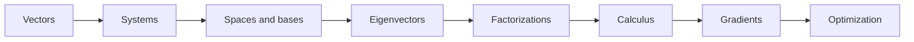

# Essential Mathematics Midterm Guide

## Exam Facts

- Course: Essential Mathematics for Data Science.
- Code: DSE ZC411.
- Exam: 19 September 2026, morning.
- Weight: 30 percent.
- Type: closed book.
- Scope: contact sessions 1–8.

## Evidence Used

- [Maths/Handout.md](Maths/Handout.md) defines scope and assessment.
- `Maths/Class material/Lecture 1.pdf` through `Lecture_8.pdf` provide taught content.
- [Lecture_8.pdf](Maths/Class%20material/Lecture_8.pdf) supplies continuous optimization and convexity.
- [Lecture_2a.pdf](Maths/Class%20material/Lecture_2a.pdf) adds handwritten vector-space and span examples.
- [Lecture_3a.pdf](Maths/Class%20material/Lecture_3a.pdf) adds a handwritten independence example.
- [Webinar 1](Maths/Class%20material/Webinar_1_slides%28EMD%2025th%29.pdf) provides worked sessions 1–3 revision.
- [Webinar 2](Maths/Class%20material/Webinar%202.pdf) provides worked sessions 4–6 revision.
- `Maths/Assignment/ASSIGNMENT_1_SOLUTIONS.md` provides the preferred proof pattern.
- `Maths/Assignment/QUIZ_1_EXAM_SHEET.md` provides short question patterns.

## Webinar Revision Map

| Source | Strongest worked practice |
|---|---|
| Webinar 1 | Row reduction, systems, subspaces, bases, null spaces, inverses |
| Webinar 2 | Eigenproblems, diagonalization, SVD, Cholesky, QR, approximation, chain rule |

- Use webinars for methods, not as proof of guaranteed questions.

## Symbols First

| Symbol | Plain meaning |
|---|---|
| $\mathbb{R}$ | All real numbers |
| $\mathbb{R}^n$ | Every list containing $n$ real numbers |
| $A\in\mathbb{R}^{m\times n}$ | Matrix with $m$ rows and $n$ columns |
| $x_i$ | Entry $i$ inside vector $x$ |
| $A^T$ | Matrix rows changed into columns |
| $A^{-1}$ | Matrix undoing multiplication by $A$ |
| $I$ | Identity matrix; matrix version of one |
| $\lambda$ | A scalar, usually an eigenvalue |
| $\lVert x\rVert$ | Length of vector $x$ |
| $\nabla f$ | Gradient; first derivatives collected together |
| $H$ | Hessian; second derivatives arranged as a matrix |
| $\Sigma$ | Diagonal matrix containing singular values |

## Big Picture

## Session 1: Vectors, Matrices, Systems

### Core Meanings

- A scalar is one number.
- A vector is an ordered list of numbers.
- A matrix stores numbers using rows and columns.
- A dot product measures directional agreement.
- A linear system contains several connected linear equations.
- A pivot is a row's first non-zero entry.
- A free variable can take any real value.

### Essential Formulas

$$
x\cdot y=\langle x,y\rangle=\sum_{i=1}^{n}x_i y_i
$$

- Multiply matching entries, then add every product.

$$
Ax=b
$$

- $A$: known coefficients.
- $x$: unknown values.
- $b$: required outputs.

### Three Legal Row Operations

1. Swap two rows.
2. Multiply one row by any non-zero number.
3. Add one row's multiple to another row.

### Gaussian Elimination

1. Form the augmented matrix $[A\mid b]$.
2. Create zeros below each pivot.
3. Continue until row echelon form appears.
4. Back-substitute for remaining unknowns.
5. Check the solution inside $Ax=b$.

### Solution Types

| Matrix clue | Meaning |
|---|---|
| Pivot for every unknown | One solution |
| Free variable without contradiction | Infinitely many solutions |
| $[0\ \cdots\ 0\mid c]$, $c\neq0$ | No solution |

### General Solution

$$
x_g=x_p+x_h
$$

- $x_p$: one particular solution satisfying $Ax_p=b$.
- $x_h$: every homogeneous solution satisfying $Ax_h=0$.
- Verify using $A(x_p+x_h)=b+0=b$.

### Matrix Inverse

$$
[A\mid I]\longrightarrow[I\mid A^{-1}]
$$

- An inverse exists only when every column has a pivot.
- Never divide by a matrix.
- Multiply by its inverse instead.

## Session 2: Vector Spaces And Subspaces

### Core Meanings

- A linear combination stretches vectors, then adds them.
- Span contains every possible linear combination.
- Independent vectors provide genuinely different directions.
- A subspace remains closed under addition and scaling.
- Every subspace must contain the zero vector.

### Linear Combination

$$
v=\lambda_1v_1+\lambda_2v_2+\cdots+\lambda_kv_k
$$

- Each $\lambda_i$ is an adjustable real number.

### Independence Test

$$
\lambda_1v_1+\cdots+\lambda_kv_k=0
$$

- Only zero coefficients mean independence.
- Any non-zero coefficient solution means dependence.

### Subspace Test

1. Show the set sits inside its parent space.
2. Show the zero vector belongs.
3. Show adding members stays inside.
4. Show scaling any member stays inside.
5. State inherited vector-space rules.

### Fast Failure Checks

- A non-zero equation's right side usually excludes zero.
- Inequalities usually fail negative scaling.
- Products between coordinates usually fail addition.
- One counterexample disproves a subspace claim.

## Session 3: Basis, Dimension, Transformations

### Core Meanings

- A basis is independent and spans the whole space.
- Dimension counts vectors inside any basis.
- Rank counts pivot columns.
- Nullity counts free variables.

$$
\operatorname{rank}(A)+\operatorname{nullity}(A)=n
$$

- $n$: number of columns.
- Rank: number of pivots.
- Nullity: number of free variables.

### Basis Rules

- Column-space basis uses original pivot columns.
- Row-space basis uses non-zero echelon rows.
- Null-space basis uses one vector per free variable.
- Never use reduced columns for a column-space basis.

### Linear Transformation

$$
T(u+v)=T(u)+T(v)
$$

$$
T(\alpha u)=\alpha T(u)
$$

- Both rules must hold for every input.
- A linear transformation always maps zero to zero.

## Session 4: Eigenvalues And Eigendecomposition

### Core Meanings

- An eigenvector keeps its direction after transformation.
- An eigenvalue tells how that direction scales.
- The zero vector is never an eigenvector.
- An eigenspace contains eigenvectors and zero.

$$
Av=\lambda v,
\qquad v\neq0
$$

### Finding Eigenvalues

1. Form $A-\lambda I$.
2. Compute $\det(A-\lambda I)$.
3. Set the determinant equal to zero.
4. Solve for every $\lambda$.

### Finding Eigenvectors

1. Choose one eigenvalue $\lambda$.
2. Solve $(A-\lambda I)v=0$.
3. Write the eigenspace basis.
4. Verify $Av=\lambda v$.

### Trace And Determinant Checks

$$
\operatorname{tr}(A)=\sum_i a_{ii}
$$

- Trace equals the eigenvalue sum, counting multiplicity.
- Determinant equals the eigenvalue product, counting multiplicity.

### Diagonalization

$$
A=PDP^{-1}
$$

- Columns of $P$ are independent eigenvectors.
- Matching eigenvalues occupy $D$ in corresponding order.
- Diagonalization needs enough independent eigenvectors.

### Spectral Theorem

- Every real symmetric matrix has real eigenvalues.
- Its eigenvectors can form an orthonormal basis.

### Cholesky Factorization

$$
A=LL^T
$$

- $A$ must be symmetric and positive definite.
- $L$ is lower triangular with positive diagonal entries.

## Session 5: QR, SVD, Low-Rank Approximation

### QR Factorization

$$
A=QR,
\qquad R=Q^TA
$$

- $Q$ has orthonormal columns.
- $R$ is upper triangular.
- Gram-Schmidt builds $Q$ from independent columns.

$$
u_k=a_k-\sum_{j=1}^{k-1}\langle a_k,e_j\rangle e_j
$$

$$
e_k=\frac{u_k}{\lVert u_k\rVert}
$$

- Subtract old directions before normalization.
- Verify $Q^TQ=I$.

### Singular Value Decomposition

$$
A=U\Sigma V^T
$$

- SVD works for rectangular matrices.
- Columns of $V$ come from eigenvectors of $A^TA$.
- Singular values are square roots of corresponding eigenvalues.
- Columns of $U$ are left singular vectors.

$$
u_i=\frac{Av_i}{\sigma_i}
$$

### Low-Rank Approximation

$$
A=\sum_{i=1}^{r}\sigma_i u_i v_i^T
$$

$$
\widehat A_k=\sum_{i=1}^{k}\sigma_i u_i v_i^T
$$

- Keep the largest singular values first.
- Smaller $k$ gives stronger compression.
- Larger $k$ keeps more original information.

## Session 6: Multivariable Calculus

### Derivative

$$
f'(x)=\lim_{h\to0}\frac{f(x+h)-f(x)}{h}
$$

- A derivative measures immediate change.

### Common Rules

$$
(fg)'=f'g+fg'
$$

$$
(g\circ f)'(x)=g'(f(x))f'(x)
$$

- Product rule handles multiplied functions.
- Chain rule handles functions inside functions.

### Taylor Polynomial

$$
T_n(x)=\sum_{k=0}^{n}\frac{f^{(k)}(x_0)}{k!}(x-x_0)^k
$$

- Taylor terms approximate a function near $x_0$.

### Partial Derivative

- Change one variable while holding others fixed.

$$
\nabla f=
\begin{bmatrix}
\frac{\partial f}{\partial x_1}&\cdots&\frac{\partial f}{\partial x_n}
\end{bmatrix}
$$

- The gradient collects all first partial derivatives.

## Session 7: Matrix Gradients And Hessians

### Useful Gradient Identities

$$
\frac{\partial(x^Ta)}{\partial x}=a^T
$$

$$
\frac{\partial(a^TXb)}{\partial X}=ab^T
$$

$$
\frac{\partial(x^TBx)}{\partial x}=x^T(B+B^T)
$$

- Check matrix dimensions before trusting any derivative.

### Hessian

$$
H_{ij}=\frac{\partial^2 f}{\partial x_i\partial x_j}
$$

- The Hessian records curvature using second derivatives.
- Critical points satisfy $\nabla f=0$.

### Two-Variable Critical Point Test

$$
D=f_{xx}f_{yy}-f_{xy}^2
$$

| Condition | Conclusion |
|---|---|
| $D>0$ and $f_{xx}>0$ | Local minimum |
| $D>0$ and $f_{xx}<0$ | Local maximum |
| $D<0$ | Saddle point |
| $D=0$ | Test gives no answer |

### First-Order Taylor Approximation

$$
f(x,y)\approx f(x_0,y_0)+f_x\Delta x+f_y\Delta y
$$

- Evaluate both derivatives at $(x_0,y_0)$.

## Session 8: Optimization Fundamentals

> Source: `Maths/Class material/Lecture_8.pdf`, plus handout scope.

### Core Meanings

- An objective function measures solution quality; we minimize it.
- Continuous optimization splits into unconstrained and constrained branches.
- Unconstrained means no equations or inequalities restrict $x$.
- A convex set contains every segment joining its points.
- A convex function has no misleading local minimum.

### Unconstrained Optimization

- Assume the objective $f$ is differentiable.
- Move along the negative gradient to decrease $f$.
- Stop where the gradient becomes zero.
- Such stationary points may be minima or maxima.

### Analytic Minimization Example

$$
f(x)=x^4+7x^3+5x^2-17x+3
$$

$$
f'(x)=4x^3+21x^2+10x-17,
\qquad
f''(x)=12x^2+42x+10
$$

1. Set $f'(x)=0$ to locate stationary points.
2. A cubic derivative gives three such points.
3. Use $f''$ to classify each point.
4. Positive $f''$ means local minimum.

### Gradient Descent

$$
x_{i+1}=x_i-\alpha_i\big((\nabla f)(x_i)\big)^T
$$

- Used when no closed-form minimum exists.
- $i$: current iteration number.
- $\alpha_i>0$: step size, also called learning rate.
- Small $\alpha$ guarantees $f(x_1)\le f(x_0)$.
- The sequence $f(x_0)\ge f(x_1)\ge\cdots$ reaches a local minimum.

### Learning-Rate Effects

| Constant rate | Behaviour |
|---|---|
| Large | Nears the optimum fast, then oscillates around it |
| Small | Converges reliably but very slowly |
| Decaying | Large strides first, slow careful finish |

### Learning-Rate Decay

$$
\text{exponential decay: }\alpha_i=\alpha_0e^{-\kappa i}
$$

$$
\text{inverse decay: }\alpha_i=\frac{\alpha_0}{1+\kappa i}
$$

- $\alpha_0$: starting learning rate.
- $\kappa$: controls how fast the rate decays.
- Step decay instead divides $\alpha$ every few iterations.

### Gradient Descent With Momentum

$$
x_{i+1}=x_i-\alpha_i\big((\nabla f)(x_i)\big)^T+\Delta x_i
$$

$$
\Delta x_i=\beta(x_i-x_{i-1}),
\qquad
\Delta x_0=0,
\qquad
0<\beta<1
$$

- Plain descent crawls when surface curvature is poorly scaled.
- Momentum reuses the previous move as extra push.
- The update mixes current and previous gradients.

### Convex Set

$$
x,y\in C\implies\theta x+(1-\theta)y\in C
$$

- $\theta$ lies between zero and one.
- The segment joining any two members stays inside.

### Convex Function

$$
f(\theta x+(1-\theta)y)\le\theta f(x)+(1-\theta)f(y)
$$

- The domain of $f$ must be a convex set.
- The chord never dips below the curve.

$$
f(y)\ge f(x)+\nabla_xf(x)(y-x)
$$

- Equivalent gradient criterion: tangent lines stay below.

### Convexity Check Example

Take $f(x)=x\log_2x$ for $x>0$, with $x=2$, $y=4$, $\theta=0.5$.

1. Chord test: $f(3)=3\log_23\approx4.75$.
2. Weighted value: $0.5f(2)+0.5f(4)=\log_232=5$.
3. Since $4.75\le5$, the definition holds.
4. Gradient test: $\nabla f=\log_2x+\dfrac{1}{\log_e2}$.
5. Tangent estimate $f(2)+\nabla f(2)\times2\approx6.9\le f(4)=8$.

### Constrained Optimization

$$
\min_x f(x)
\quad\text{subject to}\quad
g_i(x)\le0,\; h_j(x)=0
$$

- $f$: cost function being minimized.
- $g_i$: $m$ inequality constraints, $i=1,\dots,m$.
- $h_j$: $p$ equality constraints, $j=1,\dots,p$.
- Convex $f$, $g_i$, $h_j$ give a convex optimization problem.
- Convex problems guarantee a global optimum.

### Linear Programming Example

$$
\min_{x,y}\;2x+2y
$$

$$
x+y\le10,\quad 2x+y\ge10,\quad x\ge0,\quad y\ge0
$$

- Linear objective plus linear constraints is linear programming.
- Every linear programme is a convex optimization problem.

### Regularization Idea

$$
\text{new loss}=\text{data loss}+\lambda\times\text{penalty}
$$

- Larger $\lambda$ gives stronger complexity control.
- Never confuse regularization $\lambda$ with an eigenvalue automatically.

## Professor-Style Proof Template

1. Write `AIM` once for the whole question.
2. State `To prove` for each smaller step.
3. State assumptions using arbitrary members.
4. Show every algebraic or row-operation step.
5. Finish each step using `Thus`.
6. Finish the whole proof using `Hence`.

## Mark-Saving Checks

- Name every row operation.
- Label pivot and free variables.
- State rank consistency before solving.
- Show full vector factoring before new parameters.
- Verify particular vectors using $Ax_p=b$.
- Verify null vectors using $Ah=0$.
- Match $P$ columns with $D$ entries.
- Check $Q^TQ=I$ after QR.
- Check SVD matrix dimensions.
- Check gradient and Hessian dimensions.

## Practice Ladder

1. Multiply two matrices correctly.
2. Reduce one augmented matrix fully.
3. classify its solution count.
4. Write its particular and homogeneous solutions.
5. Prove one set is a subspace.
6. Disprove one set using a counterexample.
7. Find column, row, and null-space bases.
8. Verify one linear transformation.
9. Find eigenvalues and eigenvectors.
10. Build one eigendecomposition.
11. Perform one Gram-Schmidt calculation.
12. Compute one small SVD.
13. Differentiate one nested function.
14. Compute one gradient and Hessian.
15. Classify one critical point.
16. Perform three gradient-descent updates.
17. Repeat those updates with momentum added.
18. Test one function for convexity both ways.
19. Write one constrained problem in standard form.

## Recall Checklist

- Can I explain every symbol aloud?
- Can I name all three row operations?
- Can I distinguish span, basis, rank, and nullity?
- Can I derive eigenvectors after finding eigenvalues?
- Can I explain every factorization's purpose?
- Can I classify critical points using the Hessian?
- Can I explain gradient descent without notes?
- Can I write both learning-rate decay formulas?
- Can I state the momentum update correctly?
- Can I test convexity by chord and gradient?