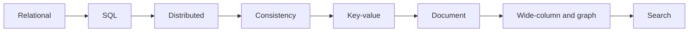
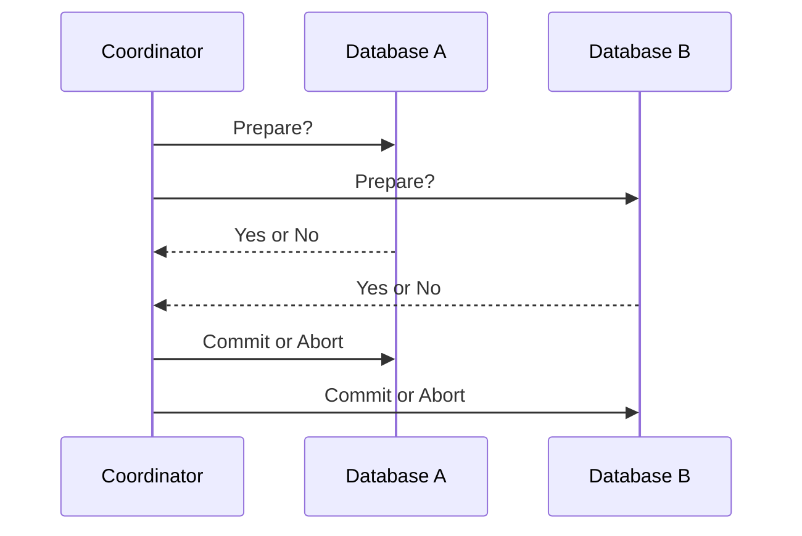

m# Modern Databases Midterm Guide

## Exam Facts

- Course: Modern Databases.
- Code: DSE ZG507.
- Exam: 20 September 2026, afternoon.
- Weight: 30 percent.
- Type: closed book.
- Scope: sessions 1–8.

## Evidence Used

- [ModernDb/Handout.md](ModernDb/Handout.md) defines scope and assessment.
- Lecture one directly covers session 1.
- Lecture two directly covers session 2.
- Lecture three directly covers session 3.
- Lesson four directly covers session 4.
- Lecture five directly covers session 5.
eans
- [Seminar 1](ModernDb/Class%20Material/Modern_Databases_Seminar_1.pptx) adds worked PostgreSQL and Redis examples.
- [Live SQL](ModernDb/Class%20Material/Modern_Databases_Seminar_1_Live_SQL.sql) demonstrates every PostgreSQL step.
- [Redis demo](ModernDb/Class%20Material/redis_ecommerce_demo.py) demonstrates five key-value operations.
- Sessions 6–8 currently have handout coverage only.
- No local ModernDB assignment folder exists.

## Big Picture



## Session 1: Structured Data Foundations

### Data Ladder

- Data means raw recorded facts.
- Information means data with context.
- Knowledge means useful understanding supporting decisions.

### Database And DBMS

- A database is an organized collection of related data.
- DBMS means Database Management System.
- A DBMS controls storage, queries, security, recovery, and concurrency.
- A database contains data; a DBMS manages that data.

### Why File Systems Fail

- Redundancy stores the same fact repeatedly.
- Inconsistency means repeated copies disagree.
- Isolation makes combined questions difficult.
- Weak security exposes files too broadly.
- Manual recovery risks permanent data loss.

### Structured Data Words

| Word | Plain meaning |
|---|---|
| Schema | Database blueprint |
| Instance | Current stored data |
| Metadata | Information describing data |
| Record | One complete row |
| Attribute | One named column |
| Domain | Allowed values for an attribute |

### Relational Model

- A relation is usually shown as a table.
- A tuple is one row.
- An attribute is one column.
- A primary key uniquely identifies each row.
- A foreign key points toward another table's primary key.
- Referential integrity prevents links toward missing rows.

### Entity-Relationship Modeling

- An entity is a stored real-world thing.
- An attribute describes an entity.
- A relationship connects entities.
- Cardinality describes relationship counts.

| Cardinality | Example |
|---|---|
| One-to-one | Person and passport |
| One-to-many | Department and students |
| Many-to-many | Students and courses |

- Many-to-many relationships usually require a junction table.
- Foreign keys normally sit on the many side.

### Normalization

- Normalization reduces repeated facts and update problems.
- Keep one fact in one suitable place.
- Connect separated facts using keys.

## Session 2: SQL And Transactions

### SQL Families

| Family | Purpose | Commands |
|---|---|---|
| DDL | Defines structures | `CREATE`, `ALTER`, `DROP` |
| DML | Changes rows | `INSERT`, `UPDATE`, `DELETE` |
| DQL | Retrieves rows | `SELECT` |

### Constraints

- `PRIMARY KEY` gives stable row identity.
- `FOREIGN KEY` protects valid relationships.
- `UNIQUE` prevents repeated values.
- `NOT NULL` requires a value.
- `CHECK` enforces a condition.

### Query Reading Order

1. `FROM` chooses source tables.
2. `WHERE` filters individual rows.
3. `GROUP BY` creates groups.
4. `HAVING` filters completed groups.
5. `SELECT` chooses returned expressions.
6. `ORDER BY` controls final ordering.

### Tiny Query

```sql
SELECT city, COUNT(*) AS customer_count
FROM customers
WHERE active = 1
GROUP BY city
HAVING COUNT(*) >= 10
ORDER BY customer_count DESC;
```

- `WHERE` acts before grouping.
- `HAVING` acts after grouping.
- Output order is unreliable without `ORDER BY`.

### Query Plans And Indexes

- `EXPLAIN` shows the selected execution plan without running the query.
- `EXPLAIN ANALYZE` runs the query and reports actual work.
- A sequential scan checks table rows directly.
- An index scan follows an index toward matching rows.
- High selectivity means a condition returns relatively few rows.
- Low selectivity can make a sequential scan cheaper.
- `ANALYZE` refreshes statistics used for row estimates.
- Compare estimated rows with actual rows before tuning.

### Join Types

| Join | Returned rows |
|---|---|
| Inner join | Matching rows only |
| Left join | Every left row, plus matches |
| Full join | Every row from both sides |
| Cross join | Every possible row pair |
| Self join | One table joined with itself |

- One-to-many joins can multiply parent rows.
- Missing join conditions can create huge outputs.

### Subqueries And CTEs

- A subquery is a query inside another query.
- `EXISTS` checks whether matching rows exist.
- A correlated subquery uses the current outer row.
- CTE means Common Table Expression.
- A CTE names an intermediate query result.

### Transaction Meaning

- A transaction is one logical work unit.
- `COMMIT` permanently accepts changes.
- `ROLLBACK` cancels uncommitted changes.

### ACID

| Letter | Meaning |
|---|---|
| Atomicity | Everything succeeds, or nothing remains |
| Consistency | Rules remain valid after completion |
| Isolation | Concurrent work behaves safely |
| Durability | Committed changes survive failures |

### Concurrency Problems

- Dirty read sees another transaction's uncommitted value.
- Non-repeatable read sees one row change unexpectedly.
- Phantom read sees matching rows appear or disappear.

### Schema Evolution

- Use ordered migration scripts.
- Prefer backward-compatible additions first.
- Backfill old rows before requiring non-null values.
- Denormalization deliberately duplicates data for faster reads.
- Denormalization improves speed but complicates consistency.

## Session 3: Distributed Database Foundations

### Core Meaning

- A distributed database stores data across networked sites.
- Users should experience one coordinated system.
- A node is one participating machine.
- Local autonomy allows sites to manage local operations.

### Why Distribute Data

- Horizontal scaling adds machines.
- Replicas improve availability.
- Regional copies reduce user latency.
- Parallel processing can increase throughput.
- Distribution increases coordination complexity.

### Architecture Comparisons

| Architecture | Main idea |
|---|---|
| Centralized | One main database location |
| Client-server | Clients request services from database servers |
| Peer-to-peer | Nodes share comparable responsibilities |
| Shared-nothing | Each node owns separate hardware resources |
| Federated | Independent databases provide a combined view |

### Transparency

- Location transparency hides physical data location.
- Fragmentation transparency hides data splitting.
- Replication transparency hides duplicate copies.

### Partitioning

| Type | Split method | Strength | Risk |
|---|---|---|---|
| Horizontal | Rows | Parallel row access | Skewed partitions |
| Vertical | Columns | Focused column access | Reconstruction joins |
| Range | Key intervals | Fast range queries | Hot ranges |
| Hash | Hash result | Even distribution | Weak range queries |
| Geographic | Physical region | Lower latency | Regional imbalance |

- A partition key decides record placement.
- A hot key overloads one partition.
- Rebalancing moves data after workload changes.
- Cross-partition joins add network cost.

### Partition Pruning And Sharding

- Partition pruning skips partitions impossible for the filter.
- Pruning works best when filters use the partition key.
- Sharding distributes data across independent database instances.
- Partitioning may occur inside one database or each shard.

### Replication

| Strategy | Main idea | Main risk |
|---|---|---|
| Leader-follower | Leader accepts writes | Leader bottleneck |
| Multi-leader | Several leaders accept writes | Write conflicts |
| Leaderless | Any replica accepts requests | Complex reconciliation |
| Synchronous | Waits for replicas | Higher latency |
| Asynchronous | Returns before replicas finish | Stale reads |

### Quorum Symbols

- $N$: total replicas.
- $W$: replicas confirming a write.
- $R$: replicas consulted for a read.
- $R+W>N$ creates read-write overlap.
- Quorums improve confidence but add latency.

## Session 4: Transactions, Queries, CAP

### Two-Phase Commit



1. Coordinator asks every participant to prepare.
2. Participants record readiness and vote.
3. Every yes vote produces commit.
4. Any no vote produces abort.
5. Coordinator failure may leave participants blocked.

### Distributed Query Processing

1. Parse and validate the query.
2. Locate required data.
3. Build possible distributed plans.
4. Estimate network and processing costs.
5. Execute the cheapest suitable plan.
6. Combine partial results.

- Selection pushdown filters rows near storage.
- Projection pushdown removes unused columns early.
- Query shipping moves computation toward data.
- Data shipping moves records toward computation.

### CAP Theorem

| Letter | Meaning |
|---|---|
| C | Every read sees coherent current data |
| A | Every request receives a non-error response |
| P | System continues despite broken network links |

- CAP trade-offs matter when a network partition occurs.
- CP may reject requests to protect consistency.
- AP may return stale data to protect availability.
- CAP does not mean choosing only two forever.

### Consistency Models

- Strong consistency returns the newest committed value.
- Eventual consistency allows temporary differences before convergence.
- Read-your-writes shows users their own completed changes.
- Monotonic reads never move one user backwards.
- Causal consistency preserves cause-before-effect ordering.

### BASE

- BASE means Basically Available, Soft state, Eventual consistency.
- BASE favors availability and scale over immediate agreement.
- One application may use both ACID and BASE systems.

## Session 5: NoSQL And Key-Value Stores

### NoSQL Meaning

- NoSQL commonly means Not Only SQL.
- It describes several non-relational database families.
- NoSQL does not replace every relational system.
- Design begins with expected access patterns.

### SQL Versus NoSQL

| Need | Usually suitable |
|---|---|
| Complex joins | Relational database |
| Strict multi-row transactions | Relational database |
| Flexible nested records | Document database |
| Extremely fast known-key lookup | Key-value store |
| Relationship traversal | Graph database |
| Massive sparse writes | Wide-column store |

### Key-Value Model

- A unique key identifies one stored value.
- `GET(key)` retrieves that value.
- `SET(key,value)` creates or replaces it.
- Values may contain text, JSON, counters, or bytes.
- Field-based searches are usually weak.

### Distribution And Storage

- Hashing maps keys toward partitions.
- Consistent hashing reduces movement when nodes change.
- Replication protects against node failures.
- A write-ahead log protects recent writes.
- A memtable keeps fresh writes in memory.
- LSM trees later merge sorted disk files.

### Operational Features

- TTL means Time To Live.
- TTL automatically removes temporary keys.
- LRU removes least recently used entries.
- LFU removes least frequently used entries.
- Compare-and-set supports conditional atomic updates.

### Redis Structures From Seminar 1

| Structure | Demonstrated use |
|---|---|
| String | Product stock status |
| Hash | Product fields under one key |
| Expiring string | Temporary session using TTL |
| Counter | Atomic product-view increments |
| Sorted set | Popularity leaderboard |

### Strong Use Cases

- Caches reduce primary database traffic.
- Session stores hold temporary login state.
- Shopping carts need fast repeated updates.
- Rate limiters use atomic counters.
- Idempotency keys prevent duplicate request processing.

### Poor Use Cases

- Complex field searches fit poorly.
- Many-to-many relationships fit poorly.
- Large multi-key transactions fit poorly.
- Reporting with many joins fits poorly.

## Session 6: Document Databases

> Confirmed by the handout; no dedicated local session-six deck exists.

### Core Meaning

- A document database stores self-contained, flexible records.
- Documents commonly resemble JSON objects.
- BSON is a binary JSON-like representation.
- A collection groups related documents.
- Schema flexibility still requires data rules.

### Design Choices

- Embed data read and changed together.
- Reference data shared across many documents.
- Embedding improves single-document reads.
- Referencing reduces repeated shared data.

### Suitable Uses

- Product catalogs have varying attributes.
- User profiles contain nested preferences.
- Content systems store varied document shapes.

### Common Traps

- Schema-less never means structure-less.
- Unlimited embedding can create oversized documents.
- Flexible schemas can produce inconsistent records.

## Session 7: Wide-Column And Graph Databases

> Confirmed by the handout; no dedicated local session-seven deck exists.

### Wide-Column Stores

- A row key locates distributed records.
- Column families group related columns.
- Sparse rows may contain different columns.
- Queries should follow partition-key design.
- They suit high-volume distributed writes.

### Graph Databases

- A node represents an entity.
- An edge represents a relationship.
- Properties describe nodes or edges.
- Traversal follows connected relationships.
- Graphs suit recommendations and fraud networks.

### Choosing Between Them

- Choose wide-column for predictable, large-scale keyed access.
- Choose graph for relationship-heavy questions.
- Never choose using data volume alone.

## Session 8: Search Databases

> Confirmed by the handout; no dedicated local session-eight deck exists.

### Core Meaning

- A search database optimizes text retrieval and ranking.
- Elasticsearch and OpenSearch are listed course examples.
- An inverted index maps terms toward matching documents.
- Relevance scoring orders stronger matches first.
- Full-text search understands analyzed text terms.

### SQL Search Comparison

| SQL retrieval | Full-text retrieval |
|---|---|
| Exact conditions dominate | Word relevance dominates |
| Structured fields work best | Natural language works best |
| Results usually remain unranked | Results receive relevance scores |

### Hybrid Search

- Hybrid search combines multiple retrieval methods.
- Structured filters may combine with text or vector search.

### Polyglot Persistence

- Polyglot persistence uses several database types together.
- Each workload receives a suitable storage model.
- More database types increase operational complexity.

## Scenario Answer Template

1. Name the chosen database type.
2. Identify the dominant access pattern.
3. Explain required consistency and scale.
4. State one important trade-off.
5. Finish with a direct recommendation.

## Likely Practice Areas

> These are predictions, not guaranteed questions.

- Convert one business story into entities and relationships.
- Explain primary and foreign keys.
- Write filtering, grouping, and joining queries.
- Compare `WHERE` and `HAVING`.
- Explain ACID using a bank transfer.
- Compare partitioning and replication.
- Draw two-phase commit and explain blocking.
- Explain CAP during a network partition.
- Compare ACID and BASE.
- Choose among four NoSQL models.
- Explain key-value storage internals.
- Compare SQL and full-text retrieval.

## Recall Checklist

- Can I distinguish database, DBMS, and application?
- Can I model entities, keys, and cardinalities?
- Can I read SQL in logical order?
- Can I explain every ACID letter?
- Can I compare partitioning strategies?
- Can I draw two-phase commit?
- Can I state CAP accurately?
- Can I choose a suitable NoSQL model?
- Can I explain inverted indexes simply?