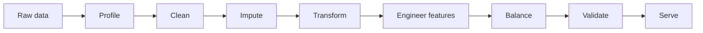

# Preprocessing For AI-Ready Data Midterm Guide

## Exam Facts

- Course: Preprocessing for AI-Ready Data.
- Code: DSE ZG505.
- Exam date: not announced in local files.
- Weight: 30 percent.
- Type: closed book.
- Scope: modules 1–8.

## Evidence Used

- [Pre Processing Of Data/Handout.md](<Pre Processing Of Data/Handout.md>) defines scope.
- Lecture PDFs numbered 1–6 directly support modules 1–7.
- Assignment one directly tests modules 1–3.
- [Lecture 05](Pre%20Processing%20Of%20Data/Class%20Material/05_EncodingCategorical_FeatureScaling.pdf) covers modules 5–6.
- [Lecture 06](Pre%20Processing%20Of%20Data/Class%20Material/06_FeatureEngineering.pdf) covers module 7.
- Module 8 currently relies on handout coverage.
- Lab archives provide practice material.
- Two presentation archives are byte-identical duplicates.

## Big Picture

## Module 1: AI-Ready Data

### Core Meaning

- AI-ready data is usable, trustworthy, documented, and model-compatible.
- Preprocessing changes raw data into model-ready data.
- Every change should have a reason and recorded evidence.

### Quality Dimensions

| Dimension | Plain meaning |
|---|---|
| Accuracy | Values match reality |
| Completeness | Required values exist |
| Consistency | Related values agree |
| Timeliness | Values remain current |
| Validity | Values follow permitted rules |
| Uniqueness | Duplicate records are controlled |

### Data Forms

| Form | Example |
|---|---|
| Structured | Customer table |
| Semi-structured | JSON event |
| Unstructured | Review text |
| Multimodal | Video, sound, and captions |

### Data Lifecycle

1. Ingest data from sources.
2. Clean quality problems.
3. Transform values and structures.
4. Engineer useful features.
5. Validate outputs and rules.
6. Serve data to models.

### Leakage Warning

- Leakage uses information unavailable during real prediction.
- Split data before learning preprocessing parameters.
- Fit preprocessing only on training data.
- Apply learned rules unchanged elsewhere.

## Module 2: Data Quality And Profiling

### Profiling Meaning

- Profiling measures structure, quality, and distributions before cleaning.
- A schema records column names, types, and rules.
- Cardinality counts distinct values.
- A threshold defines an acceptable quality boundary.

### Profiling Checklist

1. Record rows and columns.
2. Inspect column names and types.
3. Count missing values.
4. Count distinct values.
5. Detect exact duplicates.
6. Calculate numeric summaries.
7. Inspect category frequencies.
8. Test domain rules.

### Useful Quality Formulas

$$
\text{Completeness}=\frac{\text{present values}}{\text{expected values}}\times100
$$

$$
\text{Validity}=\frac{\text{valid values}}{\text{checked values}}\times100
$$

$$
\text{Uniqueness}=\frac{\text{unique records}}{\text{total records}}\times100
$$

- A non-null value can still be invalid.
- A valid value can still be inaccurate.

### Distribution Words

- Mean is the arithmetic average.
- Median is the ordered middle value.
- Variance measures squared spread around the mean.
- Skewness measures distribution asymmetry.
- Positive skew means a longer right tail.
- Kurtosis indicates tail heaviness and extreme-value tendency.

### Profiling Limits

- Profiling finds symptoms, not guaranteed causes.
- Domain experts must judge business validity.
- Thresholds depend on context.
- Automated reports still need human interpretation.

## Module 3: Missing Data And Outliers

### Missingness Types

| Type | Plain meaning | Example |
|---|---|---|
| MCAR | Missingness is unrelated to data | Random sensor failure |
| MAR | Observed fields explain missingness | Age missing by region |
| MNAR | Missing value influences missingness | Unhappy users skip ratings |

- MCAR means Missing Completely At Random.
- MAR means Missing At Random.
- MNAR means Missing Not At Random.

### Missing-Value Choices

| Method | Suitable situation | Main danger |
|---|---|---|
| Delete rows | Few random gaps | Lost information |
| Mean fill | Symmetric numeric data | Reduced variance |
| Median fill | Skewed numeric data | Ignores relationships |
| Mode fill | Simple categorical data | Inflated common category |
| KNN fill | Similar records inform values | Scaling sensitivity |
| Missing flag | Missingness carries meaning | Added complexity |

### Mean-Imputation Effect

$$
\bar{x}=\frac{1}{n}\sum_{i=1}^{n}x_i
$$

- Every inserted mean has zero distance from the mean.
- Added zero deviations reduce measured variance.
- Existing groups may move closer artificially.

### KNN Imputation

- KNN means K-Nearest Neighbours.
- It estimates missing values from nearby records.

1. Select related numeric features.
2. Scale those features.
3. Calculate distances between records.
4. Find the nearest $k$ records.
5. Combine their available values.
6. Restore the original scale.

$$
d(x,y)=\sqrt{\sum_i(x_i-y_i)^2}
$$

- Large-scale features otherwise dominate distance.
- Assignment one requires $k=3$ peers.

### Outlier Meaning

- An outlier lies unusually far from the normal pattern.
- Global outliers look unusual across all records.
- Contextual outliers look unusual inside one context.
- A rare value is not automatically an error.

### Z-Score

$$
z=\frac{x-\mu}{\sigma}
$$

- Large $|z|$ indicates distance from the mean.
- Z-scores work best with approximately normal data.

### IQR Rule

$$
IQR=Q_3-Q_1
$$

$$
\text{lower}=Q_1-1.5(IQR)
$$

$$
\text{upper}=Q_3+1.5(IQR)
$$

- IQR resists extreme values better than mean-based rules.

### Model-Based Detection

- Isolation Forest isolates unusual records quickly.
- Short isolation paths suggest anomalies.
- Local Outlier Factor compares nearby densities.
- DBSCAN finds sparse points outside dense groups.
- Model-based methods can detect multivariable anomalies.

### Treatment Decisions

- Remove impossible errors.
- Correct values when truth is known.
- Cap genuine extremes when models require stability.
- Transform strongly skewed values.
- Retain important rare cases.
- Flag uncertain values for review.

## Module 4: Duplicates And Entity Resolution

### Core Meanings

- An exact duplicate matches chosen fields exactly.
- A fuzzy duplicate differs slightly but represents one entity.
- Record linkage connects matching records across sources.
- Entity resolution creates one identity from linked records.
- A golden record is the chosen authoritative version.

### Similarity Measures

| Measure | Compares | Best use |
|---|---|---|
| Levenshtein | Character edits | Short names and codes |
| Jaccard | Shared tokens | Multi-word text |
| Cosine | Vector direction | Embeddings and long text |

$$
J(A,B)=\frac{|A\cap B|}{|A\cup B|}
$$

$$
\cos(x,y)=\frac{x\cdot y}{\lVert x\rVert\lVert y\rVert}
$$

### Resolution Workflow

1. Standardize dates, units, and labels.
2. Block records into plausible candidate groups.
3. Compare important fields.
4. Calculate matching scores.
5. Classify pairs as match, review, or non-match.
6. Cluster linked records into entities.
7. Apply survivorship rules.
8. Create the golden record.

### Confirmed Lecture Example

- The upper matching threshold is $T_u=6$.
- A score of $11.02$ becomes a match.
- This threshold belongs to that worked example.
- Never treat one example's threshold as universal.

### Common Traps

- Standardize before comparing records.
- Exact matching misses spelling variations.
- Fuzzy matching can create false matches.
- Similar topic does not guarantee identical identity.
- Keep source lineage after merging records.

## Module 5: Categorical Encoding

s> Confirmed by the handout and Lecture 05, Part 1.

### Encoding Methods

| Method | Suitable data | Main risk |
|---|---|---|
| One-hot | Unordered categories | Too many columns |
| Ordinal | Ordered categories | False spacing assumptions |
| Label | Target labels or trees | False category order |
| Target | Predictive category averages | Severe leakage |
| Frequency | Commonness matters | Different categories may collide |
| Binary | Many categories | Reduced interpretability |
| Hashing | Extremely many categories | Hash collisions |

### Safe Encoding

- Learn mappings from training data only.
- Prepare handling for unseen categories.
- Preserve genuine category order only.
- Smooth target encoding to reduce overfitting.
- Never calculate target means using test labels.

### Smoothed Target Encoding

$$
TE_s(c)=\frac{n(c)\bar{y}(c)+\alpha\bar{y}}{n(c)+\alpha}
$$

- $n(c)$: training rows containing category $c$.
- $\bar{y}(c)$: category's training-target mean.
- $\bar{y}$: overall training-target mean.
- $\alpha$: smoothing strength toward the overall mean.
- Use out-of-fold values for training rows.

### Deployment Rules

- Persist category order, mappings, statistics, hash size, and seed.
- Define unknown-category behavior before deployment.
- Monitor unknown rates, category growth, and frequency drift.

## Module 6: Scaling And Transformation

> Confirmed by the handout and Lecture 05, Part 2.

### Min-Max Scaling

$$
x'=\frac{x-x_{min}}{x_{max}-x_{min}}
$$

- Usually maps values between zero and one.
- Extreme values strongly affect its range.

### Standardization

$$
z=\frac{x-\mu}{\sigma}
$$

- Produces mean zero and standard deviation one.
- It does not guarantee a normal distribution.

### Robust Scaling

$$
x'=\frac{x-\operatorname{median}(x)}{IQR}
$$

- Median and IQR reduce outlier influence.

### Log Transformation

$$
x'=\log(1+x)
$$

- `log1p` safely accepts zero.
- Log compression reduces long positive tails.
- Negative values need another strategy.
en
### Power Transformations

- Box-Cox estimates a power for strictly positive data.
- Yeo-Johnson also supports zero and negative values.
- Fit every transformation parameter using training data only.
- Preserve fitted parameters for validation, testing, and deployment.

### When Scaling Matters

- Distance-based models require comparable feature scales.
- Gradient methods often train better after scaling.
- Principal Component Analysis depends on feature scale.
- Tree models usually ignore monotonic scale changes.

## Module 7: Feature Engineering And Selection

 > Confirmed by the handout and Lecture 06.

### Core Meanings

- Feature engineering creates useful model inputs.
- Interaction features combine variables.
- Polynomial features represent curved relationships.
- Selection removes unnecessary features.
- Reduction creates fewer replacement dimensions.
- Domain features use subject knowledge to expose useful relationships.
- Interaction terms represent combined effects between variables.
- Polynomial expansion adds powers and feature products.

### Selection Methods

| Method | Decision source | Trade-off |
|---|---|---|
| Filter | Statistical score | Fast, ignores model interactions |
| Wrapper | Repeated model testing | Accurate, expensive |
| Embedded | Model training process | Model-dependent |

### Principal Component Analysis

- PCA means Principal Component Analysis.
- PCA creates orthogonal high-variance directions.
- Standardize differently scaled inputs first.
- Components improve compression but reduce interpretation.

### PCA Workflow

1. Standardize training features.
2. Build the covariance matrix.
3. Find eigenvalues and eigenvectors.
4. Keep directions with the largest eigenvalues.
5. Project data onto those directions.
6. Apply the same scaler and projection elsewhere.

### Feature Importance And Information

- Impurity importance can favor continuous or high-cardinality features.
- Permutation importance measures performance loss after shuffling one feature.
- Mutual information detects linear and non-linear dependence.
- Zero mutual information means statistical independence.

### Feature Safety

- Build features using information available at prediction time.
- Remove identifiers without predictive meaning.
- Keep reproducible transformation code.
- Validate feature distributions after transformation.

## Module 8: Imbalanced Data

> Confirmed by the handout; no dedicated local module-eight PDF exists.

### Core Meaning

- Imbalance means one target class greatly outnumbers another.
- Accuracy may hide failure on the smaller class.

### Main Strategies

| Strategy | Action | Main risk |
|---|---|---|
| Oversampling | Adds minority examples | Overfitting |
| Undersampling | Removes majority examples | Information loss |
| SMOTE | Creates synthetic minority points | Unrealistic boundaries |
| ADASYN | Focuses difficult minority regions | Added noise |
| Class weighting | Penalizes minority mistakes more | Needs tuning |

- SMOTE means Synthetic Minority Over-sampling Technique.
- Resample training data only.
- Never balance before the train-test split.

### Better Metrics

$$
\text{Precision}=\frac{TP}{TP+FP}
$$

$$
\text{Recall}=\frac{TP}{TP+FN}
$$

$$
F_1=2\times\frac{\text{Precision}\times\text{Recall}}{\text{Precision}+\text{Recall}}
$$

- PR-AUC summarizes precision-recall behavior across thresholds.
- Recall matters when missing positives is costly.
- Precision matters when false alarms are costly.

## Assignment-One Decision Map

| Situation | Required response | Reason |
|---|---|---|
| Missing ratings | Create missingness flag | Absence carries sentiment information |
| Skewed missing fares | Fill using median | Median resists extreme surge values |
| Missing ages | Scaled KNN, $k=3$ | Related records provide local estimates |
| Distance above 200 km | Drop row | Physically impossible local trip |
| Negative fare | Drop row | Logically impossible billing value |
| Extreme valid fares | Cap at upper IQR boundary | Preserve events while limiting distortion |
| Skewed lifetime rides | Apply `log1p` | Compress positive tail |
| City-specific distance | Calculate grouped mean | Context changes normal behavior |

### Mark Distribution

- Diagnostics carry seven marks.
- Pipeline implementation carries ten marks.
- Downstream demonstration carries three marks.
- Code and visible outputs support every answer.

### Required Pipeline Order

1. Preserve the original raw dataset.
2. Profile the raw data.
3. Create meaningful missingness flags.
4. Impute missing values.
5. Remove impossible records.
6. Cap genuine extreme fares.
7. Transform skewed lifetime rides.
8. Calculate contextual city baselines.
9. Export only the final cleaned dataset.
10. Compare raw and cleaned model performance.

## Scenario Answer Template

1. Name the detected problem.
2. Choose one suitable method.
3. Explain why the data supports it.
4. State one trade-off.
5. Describe a validation check.

## Likely Practice Areas

> These are predictions, not guaranteed questions.

- Calculate completeness and uniqueness.
- Distinguish validity from accuracy.
- Compare MCAR, MAR, and MNAR.
- Explain variance compression after mean imputation.
- Calculate IQR outlier boundaries.
- Choose global or contextual detection.
- Compare exact and fuzzy matching.
- Choose a categorical encoding method.
- Calculate three scaling transformations.
- Compare filter, wrapper, and embedded selection.
- Explain the accuracy trap.
- Choose an imbalance treatment safely.

## Recall Checklist

- Can I name six quality dimensions?
- Can I profile a dataset systematically?
- Can I classify missingness correctly?
- Can I choose an imputation method?
- Can I calculate Z-score and IQR boundaries?
- Can I explain entity resolution?
- Can I choose encoding and scaling methods?
- Can I prevent preprocessing leakage?
- Can I choose imbalance metrics?