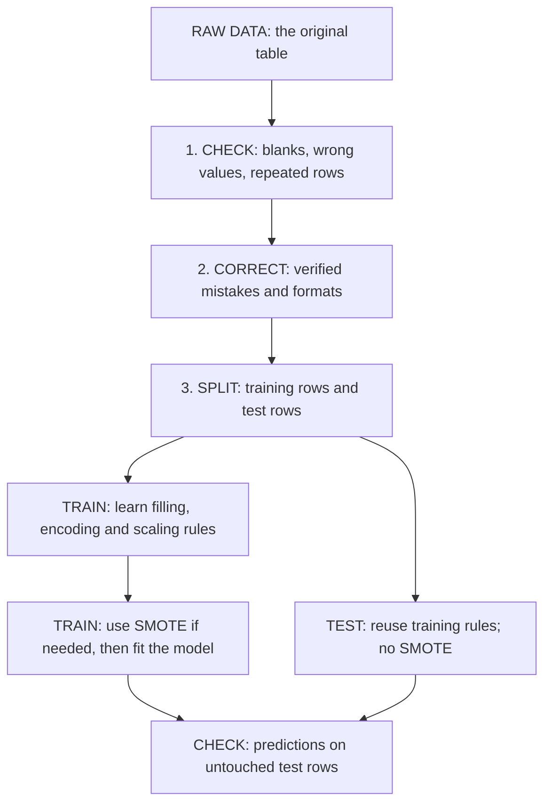
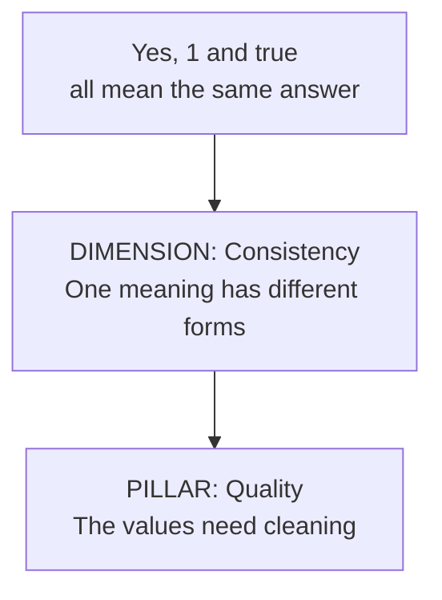
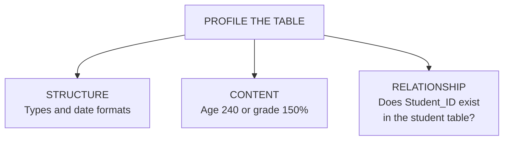
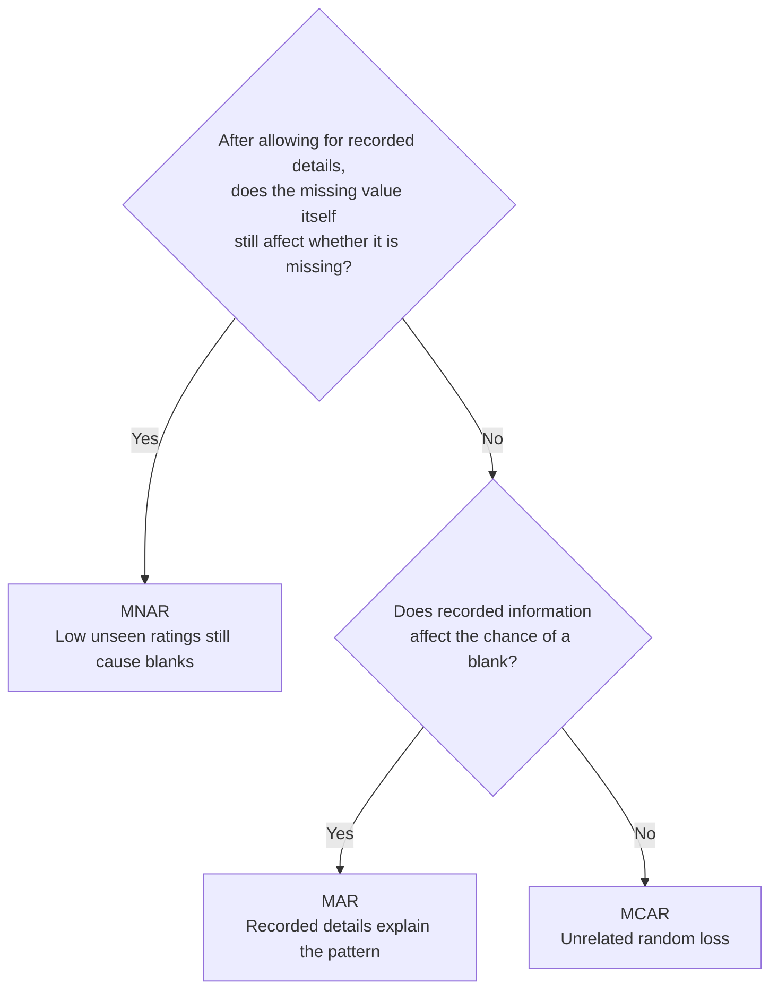
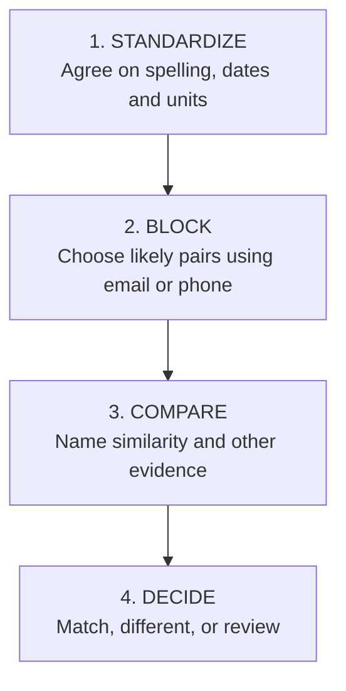
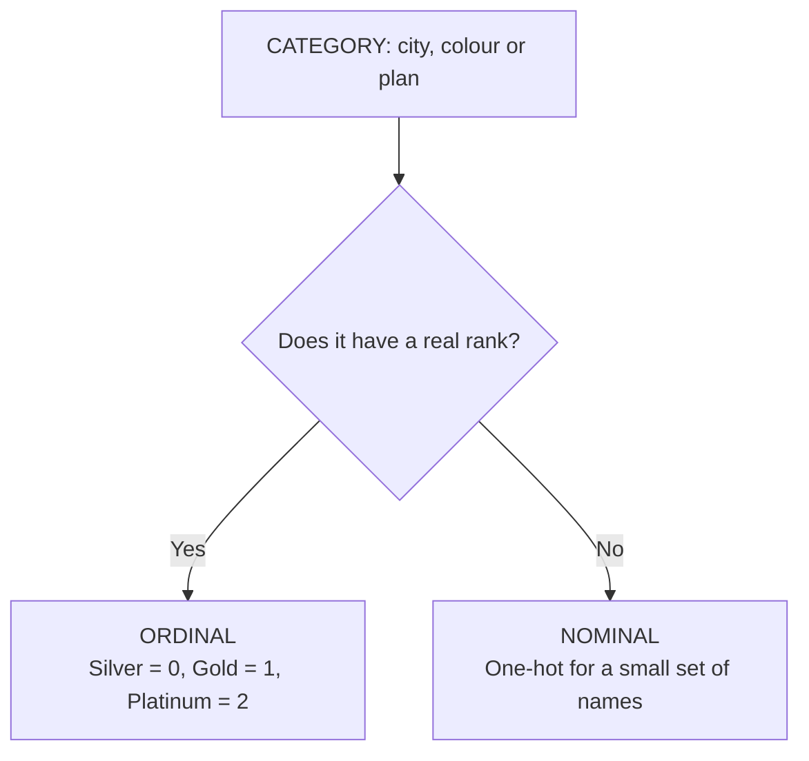
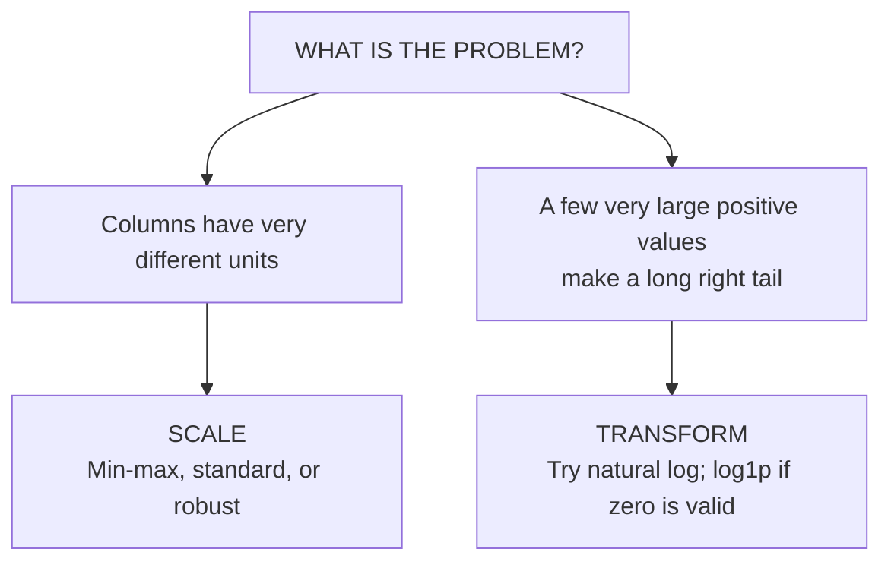
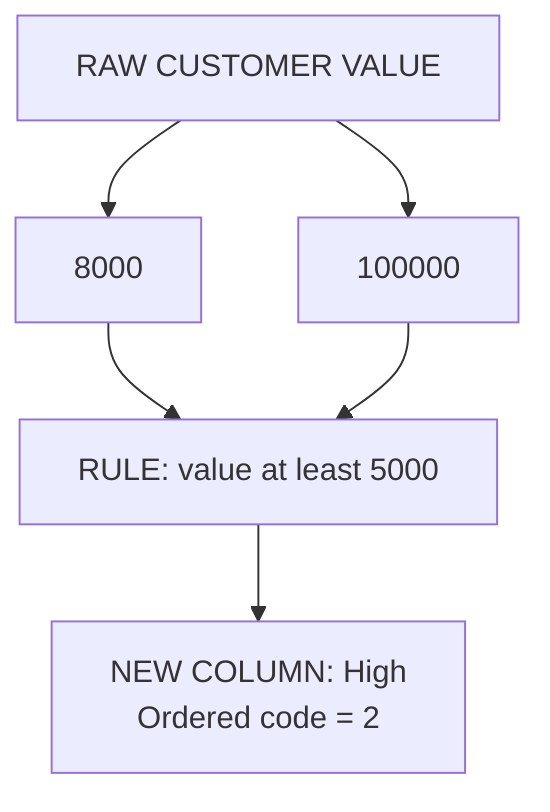
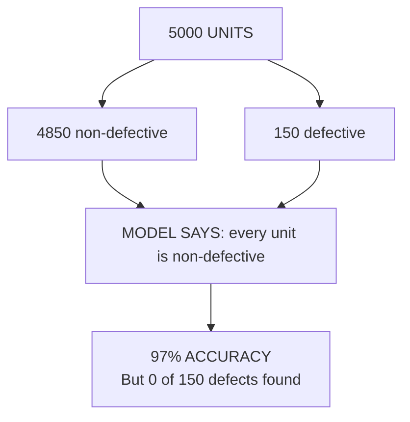
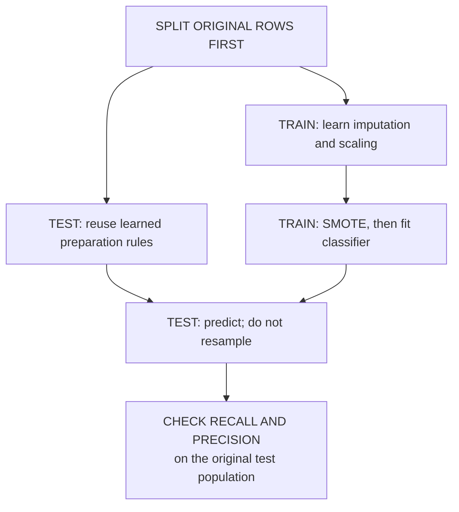

# Combined Lecture Notes: Sessions 1-8

> **ONE-DAY REVISION: START HERE**
>
> First read the **Revision Box** at the start of each session. Follow its picture, then cover the answer and try the example yourself.
>
> Your supplied exam has **6 questions, 30 marks, and 2 hours**. This guide follows that pattern. It is a revision aid, not a promise that the next paper will ask exactly the same questions.

## Your Exam Map

| Exam part | Marks | Learn these actions | Go to |
|---|---:|---|---|
| E1 | 7 | Name the problem; choose the dimension and pillar; find mean and median | [Session 1](#session-1-foundations-and-the-data-lifecycle), [Session 2](#session-2-data-quality-assessment-and-profiling) |
| E2 | 5 | Explain missingness; fill KNN blanks; calculate Z-score; choose outlier treatment | [Session 3](#session-3-missing-data-and-outliers) |
| E3 | 5 | Compare names; calculate Jaccard; fix date formats; recall hash code | [Session 4](#session-4-duplicates-inconsistencies-and-entity-resolution) |
| E4 | 5 | Choose an encoder; calculate category frequency; recall one-hot code | [Session 5](#session-5-categorical-feature-encoding) |
| E5 | 5 | Explain a long right tail; use log/scalers; create a value tier | [Session 6](#session-6-scaling-normalization-and-transformation), [Session 7](#session-7-feature-engineering-and-selection) |
| E6 | 3 | Find imbalance ratio; make one SMOTE point; explain misleading accuracy | [Session 8](#session-8-handling-imbalanced-data) |

### The Whole Subject in One Picture



> **THE RULE THAT EARNS MARKS IN MANY QUESTIONS**
>
> **Training data teaches the rules. Test data checks the result.**
>
> Do not learn a new filling value, category map, or scaler from test data. Do not use test answers. Apply SMOTE to training rows only.

### Small Dictionary

| Exam word | Everyday meaning |
|---|---|
| Feature | An input column, such as age |
| Target | The answer to predict, such as churn Yes/No |
| Impute | Fill a blank with an estimate |
| Encode | Turn category names into numbers |
| Scale | Change the size of numbers to make units comparable |
| Outlier | A value that is unusual under a stated rule; not always a mistake |
| Leakage | Information from the test or future answers enters training |
| Fit / transform | Learn a rule / apply that rule |

### One-Day Order

| Study block | Minutes | Finish when you can... |
|---|---:|---|
| Sessions 1-2 | 45 | Separate pillars from dimensions; calculate mean, median, completeness |
| Session 3 | 60 | Explain MCAR/MAR/MNAR; solve one Z-score and one IQR question |
| Sessions 4-5 | 50 | Solve Jaccard; choose encoding; identify target leakage |
| Sessions 6-8 | 65 | Scale a number; explain log; calculate SMOTE and imbalance |
| Code and formula recall | 30 | Write the tokens and formulas without looking |
| Closed-book paper | 120 | Attempt all six questions in the supplied exam |
| Mark and repair | 50 | Redo mistakes using the worked solutions |

Total: **7 focused hours**, plus breaks. Start with the core questions; study **Extra** topics only after these are secure.

> **WRITE AN EXAM ANSWER LIKE THIS**
>
> **Calculation:** formula -> put in numbers -> result -> one sentence explaining it.
>
> **Method choice:** "Use ___ because ___ in this question. Its limitation is ___."
>
> **Do not only read:** cover a worked answer and reproduce it. That is your check that you can use it in the exam.

---

- Course: DSE ZG505, Preprocessing for AI-Ready Data.
- These notes use simple English. Important exam words are kept and explained.
- E1-E6 mean questions in your exam paper. S1-S9 mean questions in the sample worksheet.
- Lecture file 05 covers two sessions: encoding and scaling. This is why seven files cover eight sessions.
- These are study answers, not an official answer key. Read sections marked **Extra** after the main topics.


**Preprocessing** means preparing the data before giving it to a model. We check mistakes, handle blanks, turn categories into numbers, and adjust values when needed.

## Session 1. Foundations and the Data Lifecycle

- Source: [01_Intro.pdf](../Class%20Material/01_Intro.pdf); handout session 1.
- Practise with: E1(a-c), S1; assignment 1.1-1.2.

### Revision Box 1: Name the Problem

> **MEANING**
>
> **Pillar = a broad need. Dimension = a specific quality check.**
>
> A table with fixed columns is **structured**, even when some cells are wrong.



| If you see... | Choose this pillar |
|---|---|
| Wrong or unusable values | Quality |
| Missing values or missing groups of people | Completeness |
| A data job repeatedly fails | Reliability |
| Private information is exposed | Trust |
| Too much data arrives too quickly | Scale |

| Dimension | Two-word reminder |
|---|---|
| Accuracy / Validity | True fact / Allowed value |
| Completeness / Consistency | Value present / Same meaning |
| Timeliness / Uniqueness | Recent enough / No duplicates |

> **WRITE IN THE EXAM**
>
> "Experience = -2 fails **Accuracy** because years of experience cannot be negative. The main pillar is **Quality**."

**Cover and answer:** a required age is blank. **Check:** Completeness dimension; Completeness pillar.

### 1.1 What Does AI-Ready Mean?

**Meaning:** the data is ready for the job we want the model to do.

For example, to predict whether customers will leave, we need useful customer details and correct past Yes/No answers. We must also protect private information.

**A neat table is not enough.** A table can look clean but contain wrong ages or leave out an important group of customers.

| Data type | Simple meaning | Example |
|---|---|---|
| Structured | Data has fixed rows and named columns | An Excel table with ID, Age, City |
| Semi-structured | Data has keys or tags, but entries can have different fields | JSON or XML files |
| Unstructured | Data is not arranged in fixed table fields | A paragraph, photo, or audio recording |
| Multimodal | Data combines different forms of information | A product photo together with its written review |

**Exam answer:** "The applicant table is structured because it has fixed rows and named columns."

A wrong value does not change the table's type. Numbers and category names in one table do not, by themselves, make it multimodal.

### 1.2 Five AI-Readiness Pillars

**Pillars** are five broad things that make data ready for AI.

| Pillar | Ask this simple question | Example problem |
|---|---|---|
| Quality | Are the values correct and usable? | Age is -5 |
| Completeness | Do we have the information and people we need? | Ratings are blank, or website customers are missing |
| Reliability | Does the data process work regularly? | A daily data-loading job fails without warning |
| Trust | Is the data used safely and responsibly? | Private card numbers are exposed |
| Scale | Can the system handle this much data this quickly? | Millions of events arrive each minute |

**Memory line:** correct data, enough data, dependable process, safe use, enough capacity.

**Exam tip:** if asked for one pillar, choose the best match and give one reason. Do not list all five.

### 1.3 Six Data-Quality Dimensions

**Dimensions** are specific checks on data quality.

| Dimension | Simple meaning | Example problem |
|---|---|---|
| Accuracy | The value agrees with the real fact | Actual age is 25, but recorded age is 52 |
| Completeness | A needed value is present | Experience is blank |
| Consistency | The same meaning is written the same way | Yes, 1, and true all mean shortlisted |
| Timeliness | The information is recent enough | A delivery uses an old address |
| Validity | The value follows the stated rule | Grade must be a letter, but a cell contains 150% |
| Uniqueness | The same person or event is not stored twice by mistake | The same registration was loaded twice |

**Accuracy versus validity:** an age of 52 may pass the rule "between 18 and 100". It is still inaccurate if the person's real age is 25.

**Pillar versus dimension:** a pillar is a broad requirement; a dimension names a specific quality issue. For mixed Yes/1/true labels, write **Consistency** when asked for a dimension and **Quality** when asked for a pillar.

One issue can fail more than one check. Negative experience is inaccurate and also breaks a rule that experience must be zero or more.

### 1.4 Worked Issue Table

| Value in the question | Dimension | Pillar | Short reason |
|---|---|---|---|
| Experience = -2 | Accuracy | Quality | A person cannot have negative years of experience |
| Experience is blank | Completeness | Completeness | A required value is missing |
| Yes, 1, true mean the same answer | Consistency | Quality | One answer has several written forms |
| B.Tech and btech mean the same degree | Consistency | Quality | The spelling should be made consistent |
| Experience = 5+, but the column requires an exact number | Validity | Quality | "At least 5" is not an exact value |

Do not change `5+` to exactly 5 without stating your assumption. Do not fill a missing target with No just because it is blank.

Two people can have the same age and degree. Matching details with different IDs are a reason to investigate, not proof of a duplicate.

### 1.5 The Lifecycle and Leakage Boundary

**Lifecycle** means the steps from collecting data to using it.

1. Decide what to predict and which information will be available then.
2. Collect the data and keep an unchanged original copy.
3. Check blanks, wrong values, repeated rows, and formats.
4. Correct known errors. Keep records from the same person together when splitting if they could reveal test answers.
5. Separate training data from test data.
6. Learn filling values, category mappings, and scaling values from training data only.
7. Apply those same rules to test data.
8. Check how well the model works on the separate test data.

**Example of leakage:** the training ages are 20 and 40, so their mean is 30. A blank test age should use the training mean, 30. Do not recalculate the mean using test ages.

**Metadata** means information about the data: column names, units, source, and collection date. **Provenance** means where the data came from and what changes were made to it.

**Remember:** learn the preparation rules on training data; reuse them on test data.

### 1.6 Exam Routine

1. Name the data type: "Structured, because it is a table with fixed columns."
2. Point to the problem: "Experience is -2."
3. Name the dimension and reason: "Accuracy, because years of experience cannot be negative."
4. If asked, name the pillar: "Quality."

**Quick check:** the daily data-loading job fails for a week. Which pillar is affected? **Answer: Reliability.**

<!-- pagebreak -->

## Session 2. Data Quality Assessment and Profiling

- Source: [02_dataQuality_Profiling.pdf](../Class%20Material/02_dataQuality_Profiling.pdf); handout session 2.
- Practise with: E1(d), S2; assignment 1.1-1.4.

### Revision Box 2: Check Before Changing

> **MEANING**
>
> **Profiling = look through the data and measure its problems.**
>
> Structure checks the arrangement. Content checks the values. Relationships check links between tables or columns.



| Asked for... | Fixed routine | Worked answer |
|---|---|---|
| Column completeness | Filled / rows x 100 | 1046 / 1240 x 100 = **84.35%** |
| Whole-table completeness | Filled / (rows x columns) x 100 | 34 / (10 x 4) x 100 = **85%** |
| Mean | Add numeric values; divide by their count | (5 - 2 + 6 + 5 + 7) / 5 = **4.2** |
| Median | Sort; take the middle | -2, 5, **5**, 6, 7 gives **5** |

> **WHY MEAN FILLING REDUCES SPREAD**
>
> Ages: 20, 30, 40, blank. Fill with 30.
>
> Squared differences still total 200. Sample variance changes from **200/2 = 100** to **200/3 = 66.67**. More values sit at the centre.

> **COMMON MISTAKE**
>
> "Numeric-only" does not mean "valid-only." Keep numeric -2 in the requested raw calculation. Skip text such as `5+` and `three`; explain their problems separately.

**Cover and answer:** who catches grade `150%` among letter grades? **Check:** Content discovery.

### 2.1 Three Profiling Types

**Profiling** means examining the data before changing it. We ask: what is in the table, and what looks wrong?

| Type | What we check | Example |
|---|---|---|
| Structure discovery | How the data is arranged; column types and formats | A date column mixes different date formats |
| Content discovery | The actual values inside the cells | A grade is 150%, but only letter grades are allowed |
| Relationship discovery | Whether related columns or tables agree | A registration uses a Student_ID not found in the student table |

**Exam answer for S2:** "Content discovery flags 150% because this value is not an allowed grade. Relationship discovery checks that each Student_ID also exists in the student table."

**Cardinality** means the number of different values. A column containing Cash, Cash, Card has cardinality 2.

### 2.2 Metrics and Their Denominators

**Completeness** tells us how much required data is present. The **denominator** is the number below the fraction line.

For one column:

$$\mathrm{Completeness}=\frac{\mathrm{filled\ cells\ in\ the\ column}}{\mathrm{total\ rows}}\times100\%$$

Example: 425 out of 500 advisor-approval cells are filled.

$$\mathrm{Completeness}=\frac{425}{500}\times100=85\%$$

For the whole table, count cells in every column:

$$\mathrm{Cell\ completeness}=\frac{\mathrm{filled\ cells}}{\mathrm{rows}\times\mathrm{columns}}\times100\%$$

A table with 10 rows and 4 columns has 40 cells. If 6 are missing, completeness is $34/40\times100=85\%$.

**Duplicate counting:** if the same row appears three times, there are two extra copies. pandas `duplicated()` marks those two; `duplicated(keep=False)` marks all three.

Replace known missing-value markers such as `?` with actual missing values before counting. Do not assume a value is correct just because it follows a format rule.

### 2.3 Mean, Median, Spread, and Shape

| Exam word | Simple meaning | What to remember |
|---|---|---|
| Mean | Add the values and divide by their count | A very large value can pull it upward |
| Median | Sort the values and take the middle | For an even count, average the two middle values |
| Variance | A measure of how far values are spread around the mean | Uses squared differences |
| Standard deviation, or SD | Square root of variance | Has the original unit, such as years |
| Skewness | Whether the values stretch more to one side | Right skew means a long tail towards larger values |
| Kurtosis | A measure related to how heavy the tails are | Useful when examining extreme values |

For values 10, 20, 30:

$$\mathrm{Mean}=\frac{10+20+30}{3}=20,\qquad\mathrm{Median}=20$$

The differences from the mean are -10, 0, 10. Their squared differences add to $100+0+100=200$.

$$\mathrm{Population\ variance}=\frac{200}{3}=66.67$$

$$\mathrm{Sample\ variance}=\frac{200}{3-1}=100$$

Use the denominator asked for. **Population** uses the count; **sample** uses count minus one. If the question is unclear, state which one you use.

**Kurtosis note:** a normal, bell-shaped distribution has Pearson kurtosis 3 or excess kurtosis 0. pandas reports the second version with `.kurt()`. These are two ways to report the same measure, not a contradiction.

### 2.4 Worked Numeric-Only Calculation

**Given:** 2, 4, -1, 7, `6+`, and one blank.

**Asked:** mean and median using only numeric entries.

1. Keep 2, 4, -1, 7. Skip the text `6+` and the blank.
2. Add and divide by 4 for the mean.

$$\bar{x}=\frac{2+4-1+7}{4}=\frac{12}{4}=3$$

3. Sort: -1, 2, 4, 7. There are two middle values, 2 and 4.

$$\mathrm{Median}=\frac{2+4}{2}=3$$

**Exam trap:** -1 may be impossible for an age or experience value, but it is still numeric. Include it when the question says "numeric entries only"; explain the error separately.

### 2.5 Why Mean Imputation Compresses Variance

**Imputation** means filling a missing value. **Variance compression** means the values appear less spread out after filling.

**Given:** ages 20, 30, 40, blank.

1. Mean of the recorded ages = $(20+30+40)/3=30$.
2. Fill the blank with 30. The list becomes 20, 30, 40, 30.
3. The sum of squared differences is still $100+0+100+0=200$.
4. The sample-variance denominator increases from 2 to 3.

$$s^2_{\mathrm{before}}=\frac{200}{3-1}=100$$

$$s^2_{\mathrm{after}}=\frac{200}{4-1}=66.67$$

**Exam answer:** "Mean filling adds values at the centre. The total squared difference stays the same, but the count increases. Therefore, the variance decreases."

It can also blur real groups, such as younger and older customers. A filled value is a guess, not a new measured age.

**Extra formula:** for $n>1$ recorded values and $m$ mean-filled values:

$$s^2_{\mathrm{after}}=\frac{n-1}{n+m-1}s^2_{\mathrm{before}}$$

### 2.6 Diagnostic Code to Recall

`df` means the table loaded into pandas. The age column must already contain numbers or missing values.

```python
completeness = df.notna().to_numpy().mean() * 100
invalid_age = (
    (df["customer_age"] < 18)
    | (df["customer_age"] > 100)
).sum()
duplicate_extras = df.duplicated().sum()
case_variants = df["payment_type"].nunique(dropna=True)
schema = {
    column: {
        "dtype": str(df[column].dtype),
        "missing": int(df[column].isna().sum()),
    }
    for column in df.columns
}
```

| Code | Meaning |
|---|---|
| `notna()` | Check whether each cell is filled |
| `isna()` | Check whether each cell is missing |
| `.sum()` on a condition | Count how many entries pass the condition |
| `duplicated()` | Find extra copies of rows |
| `nunique()` | Count different values |
| `schema` | A log of each column's data type and missing count |

The 18-100 age range is the assignment's rule. It is not a rule for every dataset.

`Cash`, `cash`, and `Card` give three raw spellings but only two payment categories after ignoring letter case. To count extra spellings caused only by case:

```python
payments = df["payment_type"].dropna().astype("string")
variants = payments.groupby(payments.str.casefold()).nunique()
extra_case_variants = (variants - 1).sum()
```

`.casefold()` makes letter case consistent for comparison. In this example there is one extra casing form: Cash versus cash.

An automatic profiling report, such as ydata-profiling, helps find possible problems. You still decide whether a strange value is wrong.

**Quick check:** 90 filled cells out of 100 means what completeness? **Answer: 90%.**

<!-- pagebreak -->

## Session 3. Missing Data and Outliers

- Source: [03_MissingData_Outliers.pdf](../Class%20Material/03_MissingData_Outliers.pdf); handout session 3.
- Practise with: E2, S3/S8; assignment 1.4 and 2.1-2.2.

### Revision Box 3: Blanks and Unusual Values

> **MEANING**
>
> **Impute = fill a blank. Outlier = unusual, not automatically wrong.**
>
> Mean = average; median = middle; KNN = use similar rows. Use a missing flag before filling when absence itself carries information.



This decision uses the scenario's stated facts. A table alone usually cannot prove MAR rather than MNAR.

| Calculation | Working | Decision |
|---|---|---|
| Z-score for 15.8 in 4.1, 4.3, 4.0, 4.4, 4.2, 15.8 | Population mean = 6.1333; SD = 4.3250; z = (15.8 - 6.1333) / 4.3250 = **2.2351** | Flag under the given rule **absolute z > 2** |
| IQR for 118, 119, 120, 121, 122, 125, 260 | Exclude middle 121: Q1 = 119; Q3 = 125; IQR = 6; upper fence = 125 + 1.5 x 6 = **134** | **260** exceeds the upper fence |

> **CODE TO REMEMBER**
>
> `KNNImputer` -> `n_neighbors=3` -> `fit_transform`.
>
> The sample worksheet uses **4** neighbours. Scale useful numeric columns before KNN; return to original units if required.

> **CHOOSE THE TREATMENT BY THE GOAL**
>
> Impossible value: correct or reject. Real extreme with limited influence required: **cap**. Right-tailed positive feature: **log**. Actual raw average required: **keep the genuine event**.

**Cover and answer:** does MAR make deleting all incomplete rows automatically unbiased? **Check:** No; the remaining rows may favour some recorded groups.

### 3.1 MCAR, MAR, and MNAR: Formal Definitions

These names describe **why values are missing**, not how many are missing.

| Name | Simple meaning | Example |
|---|---|---|
| MCAR: Missing Completely At Random | Missingness has no connection to any recorded or missing value | A random computer fault loses some answers |
| MAR: Missing At Random | Recorded information explains the chance of a blank | Income is missing more often for a recorded age group; within each age group, income itself adds no further effect |
| MNAR: Missing Not At Random | The missing value itself still affects the chance of a blank | Very unhappy customers avoid giving their low rating, even among customers with the same recorded details |

**The important MAR/MNAR question:** after comparing people with the same recorded information, does the missing value still affect whether they answer?

- No remaining effect from the missing value: MAR may be a suitable assumption.
- A remaining effect from the missing value: MNAR.

**Exam example:** customers with more support calls skip ratings more often. This alone does not prove MNAR. If low satisfaction still causes more skipped ratings within each call-count group, it is MNAR.

**Formal version for the exam:** $R$ says whether a value was recorded: 1 = recorded, 0 = missing. $Y_{obs}$ means recorded values; $Y_{mis}$ means missing values. $P$ means probability; the vertical bar means "given".

$$\mathrm{MCAR}:\quad P(R\mid Y_{\mathrm{obs}},Y_{\mathrm{mis}})=P(R)$$

$$\mathrm{MAR}:\quad P(R\mid Y_{\mathrm{obs}},Y_{\mathrm{mis}})=P(R\mid Y_{\mathrm{obs}})$$

For MNAR, $P(R\mid Y_{obs},Y_{mis})$ still depends on $Y_{mis}$ after considering $Y_{obs}$.

In real data, recorded values alone usually cannot prove MAR rather than MNAR. We need information about how answers were collected or further assumptions.

### 3.2 Choose an Imputation Strategy

**Imputation = filling a missing value with an estimate.** The best method depends on the column and the reason it is missing.

| Method | When it may help | Main problem |
|---|---|---|
| Delete the incomplete row | Only a few rows are missing for MCAR reasons | Loses data; can favour some groups over others |
| Mean: average | Numeric values have no strong one-sided tail | Outliers affect it; filling reduces spread |
| Median: middle sorted value | Numeric values have a long tail or extreme values | Still replaces different unknown values with one estimate |
| Mode: most common value | A category is missing | Can make the largest category too common |
| KNN: use similar rows | Other useful columns help identify similar people or items | Needs suitable columns and scaling; can be slow |
| Regression / iterative filling | Other columns help predict the missing value | A wrong prediction model gives poor estimates |
| Missing flag plus filling | The absence itself may be useful information | Does not fully solve MNAR bias |

**Why not delete all MAR rows?** Suppose older customers leave more blanks. Deleting those rows leaves too many younger customers. Results may no longer describe the original customer group correctly.

Even with MCAR, deletion reduces the amount of data. Do not use future answers or test targets to fill input columns.

### 3.3 Flag Before Filling

**Missing flag** means an extra column showing whether the original value was blank: 1 = blank, 0 = recorded. This is the opposite of the recorded-value indicator R above.

Example: a blank rating gets flag 1. After filling the rating with 3, the flag still tells us that 3 was a replacement.

```python
df["rating_missing"] = df["customer_rating"].isna().astype(int)
rating_median = df["customer_rating"].median()
df["customer_rating"] = df["customer_rating"].fillna(rating_median)
```

Make the flag **before** filling. In a model experiment, calculate the filling median from training rows only. A missing flag preserves information; it does not reveal the true missing rating.

### 3.4 KNN: Fixed Exam Routine

**KNN** means k-nearest neighbours. For filling an age, it finds similar rows and uses their recorded ages.

1. Choose useful numeric columns. Leave out IDs and the target.
2. Scale the columns so large units do not dominate the comparison.
3. Find k nearby rows that have a recorded value for the missing column.
4. Average those values when all neighbours have equal weight.
5. Convert back to the original units if required.

**Given:** the three chosen neighbours have ages 24, 30, 36.

$$\mathrm{Filled\ age}=\frac{24+30+36}{3}=30$$

**Why scale?** Income may be in thousands, while age is in tens. Without scaling, income can dominate distance simply because its numbers are bigger.

scikit-learn can compare rows with some missing entries. It uses the available shared columns and adjusts the distance for how many were available.

#### Exact Code-Blank Pattern

```python
import pandas as pd
from sklearn.impute import KNNImputer

knn_imp = KNNImputer(n_neighbors=3)
result = pd.DataFrame(
    knn_imp.fit_transform(df),
    columns=df.columns,
    index=df.index,
)
```

The exam blanks are **`KNNImputer`, `3`, `fit_transform`**. The sample worksheet uses **4** neighbours instead.

`fit_transform` learns from the supplied table and returns filled values. `columns` keeps column names; `index` keeps row labels. This example needs numeric data and at least some recorded values in every column.

KNN can fill blanks, but it does not automatically remove the unfair effect of MNAR missingness.

#### Scale -> Impute -> Inverse-Transform

```python
from sklearn.impute import KNNImputer
from sklearn.preprocessing import StandardScaler

columns = ["customer_age", "lifetime_rides", "distance_km"]
scaler = StandardScaler()
scaled = scaler.fit_transform(df[columns])
imputer = KNNImputer(n_neighbors=3)
completed = imputer.fit_transform(scaled)
df[columns] = scaler.inverse_transform(completed)
```

`inverse_transform` means "return to the original units," such as years instead of scaled age values.

StandardScaler leaves blanks for the imputer to fill. A completely blank column needs a separate decision because there are no recorded values to learn from.

For train/test work, use `fit_transform` on training data and the already fitted objects' `transform` on test data.

### 3.5 Z-Score: Formula and Worked Example

**Meaning:** a Z-score tells us how many standard deviations a value is above or below the mean.

$$z=\frac{\mathrm{value}-\mathrm{mean}}{\mathrm{standard\ deviation}}=\frac{x-\mu}{\sigma}$$

Here $x$ is the value, $\mu$ is the mean, and $\sigma$ is the population SD.

**Given:** 10, 10, 10, 10, 10, 40. Use population SD and flag values with $|z|>2$.

1. Find the mean.

$$\mu=\frac{90}{6}=15$$

2. Find the variance and then take its square root.

$$\sigma^2=\frac{5(10-15)^2+(40-15)^2}{6}=\frac{750}{6}=125$$

$$\sigma=\sqrt{125}=11.1803$$

3. Find the Z-score of 40.

$$z(40)=\frac{40-15}{\sqrt{125}}=2.2361$$

4. Compare with the given rule: $2.2361>2$. **Flag 40.**

The bars in $|z|$ mean ignore the sign: both very low and very high values can be unusual. If the rule were $|z|>3$, this value would not be flagged.

Always state population or sample SD. NumPy's usual default uses the count; pandas `Series.std()` uses count minus one. Extreme values can change both the mean and SD, so this method can miss some outliers.

### 3.6 IQR/Tukey Fences: Worked Example

**IQR**, or interquartile range, is the distance between the lower and upper quartiles. It measures the spread of the middle half of the data. **Fences** are limits used to flag possible outliers.

**Given:** 2, 3, 4, 5, 6, 7, 30.

1. The values are already sorted. Median = 5.
2. For this example, leave out 5 when making the two halves.
3. Lower half: 2, 3, 4, so its middle value is $Q_1=3$.
4. Upper half: 6, 7, 30, so its middle value is $Q_3=7$.

$$Q_1=3,\qquad Q_3=7,\qquad \mathrm{IQR}=7-3=4$$

5. Calculate the lower and upper limits.

$$L=Q_1-1.5\mathrm{IQR}=3-6=-3$$

$$U=Q_3+1.5\mathrm{IQR}=7+6=13$$

6. Check each value. Only **30** is below -3 or above 13, so only 30 is flagged.

A value exactly on a limit is not outside it. Some software calculates quartiles differently; say which method you use. Do not mix quartiles from one method with limits from another.

### 3.7 Global, Contextual, and Model-Based Outliers

| Term | Simple meaning | Example or caution |
|---|---|---|
| Global outlier | Unusual compared with the whole dataset | One fare is far above almost every other fare |
| Contextual outlier | Unusual within its particular group | A trip is normal in a large city but unusually long in a small city |
| Isolation Forest | Finds rows that are easy to separate from the rest using random splits | Being unusual does not prove a row is wrong |
| Local Outlier Factor, or LOF | Compares a point's nearby crowd with its neighbours' crowds | Needs suitable scaling and neighbour count |
| DBSCAN | Finds groups of nearby points and marks some isolated points as noise | Its distance and group-size settings affect the result |

Learn global versus contextual first. The last three are extra detection methods from the lecture.

A city's mean distance gives a comparison value. You still need a rule for deciding how far from that mean is unusual.

### 3.8 Remove, Cap, Transform, or Retain?

**Do not delete a value just because it is large. First ask whether it is a mistake and what you are trying to calculate.**

| Situation | Action | Simple reason |
|---|---|---|
| Impossible value, such as negative age | Correct it from the source; otherwise mark invalid or remove as the task requires | It cannot be a correct measurement |
| Real extreme value, but its influence must be limited | Cap it at a justified limit | Keep the row but stop the number becoming too large |
| Many real positive values form a long right tail | Try a log transformation | Reduce the gap between small and very large values |
| Real extreme value and the actual raw average is requested | Keep it | The real event is part of that average |

**Capping example:** with upper limit 13, replace 30 with 13. This is also called winsorizing.

**Exam distinction:** E2 asks to limit the jolt's influence, so capping is a suitable answer. If S3 asks for the actual average response time, keep the genuine delay. You can also report the median to show a typical response time.

A capped average is an adjusted average, not the original average. The average of log values is also not the original arithmetic mean.

Keep original values for checking later. Learn any data-based limits from training data only.

**Quick check:** does a Z-score prove a value is a mistake? **Answer: No. It only says the value is unusual under that rule.**

<!-- pagebreak -->

## Session 4. Duplicates, Inconsistencies, and Entity Resolution

- Source: [04_Duplicate_EntityResolution.pdf](../Class%20Material/04_Duplicate_EntityResolution.pdf).
- Practise with: E3, S4; duplicate checks in assignment 1.1.

### Revision Box 4: Do These Records Match?

> **MEANING**
>
> **Entity resolution = decide whether different-looking records describe the same person or place.**
>
> Exact matching needs equal values. Fuzzy matching allows small differences.



**Paper example:** Blue Ocean Resort & Spa versus Blue Ocean Resort and Spa. Keep `&` and `and` different, as instructed.

| Shared words: intersection | All different words: union |
|---|---|
| blue, ocean, resort, spa | blue, ocean, resort, spa, &, and |
| Count = **4** | Count = **6** |

$$J=\frac{\mathrm{shared}}{\mathrm{all\ different}}=\frac{4}{6}=\boxed{0.6667}$$

| Other exam task | Answer to remember |
|---|---|
| Johnson -> Jonson | Delete `h`: Levenshtein distance **1** |
| `07-11-2025` to ISO | **2025-11-07**, only if the source uses DD-MM-YYYY |
| No reliable common ID; partly matching fields | Probabilistic linkage combines the evidence |
| Hash-code blanks | **`hash`**, then **`seen.add(key)`** |

> **COMMON MISTAKE**
>
> A blocking key only selects a pair for comparison. It does not prove a match. Exact-name blocking can separate misspellings that should be compared.

**Cover and answer:** can an ISO output format reveal what an ambiguous input date meant? **Check:** No; we need the source-format rule.

### 4.1 Exact Versus Fuzzy Duplicates

**Duplicate:** the same record was stored again by mistake. **Deduplication:** finding and removing those extra copies.

**Entity resolution:** deciding whether two different-looking records refer to the same real person, hotel, or product. For example, `Johnson` and `Jonson` might be the same customer.

| Method | Simple meaning | Main caution |
|---|---|---|
| Exact matching | Chosen fields are exactly the same | Misses spelling differences |
| Fuzzy matching | Values are similar, even if not identical | Similar names may belong to different people |
| Deterministic linkage | Use a fixed rule, such as the same verified customer ID | A wrong or missing ID can prevent a match |
| Probabilistic linkage | Combine evidence from several fields and give stronger evidence more weight | The score and decision limits need checking |

**Usual order:** make formats consistent -> find possible pairs -> compare them -> decide whether to merge.

Do not automatically delete two genuine purchases just because their amounts are the same. Also, a newly created row ID can differ even when the remaining content is a repeated copy.

### 4.2 Jaccard Similarity: Fixed Routine

**Meaning:** compare two sets by asking what fraction of their different items they share.

- A **token** is one item, such as a word from a name.
- A **set** lists different items once, even if an item repeats.
- **Intersection:** items present in both sets.
- **Union:** all different items present in either set.

$$J(A,B)=\frac{\mathrm{number\ of\ shared\ items}}{\mathrm{number\ of\ different\ items\ in\ total}}=\frac{|A\cap B|}{|A\cup B|}$$

**Given:** "Blue River Clinic" and "Blue River Medical Clinic".

1. Use lowercase words: A = {blue, river, clinic}; B = {blue, river, medical, clinic}.
2. Shared words = {blue, river, clinic}: count 3.
3. All different words = {blue, river, medical, clinic}: count 4.
4. Divide.

$$J(A,B)=\frac{3}{4}=0.75$$

Higher means more shared items. It does not prove that the two records refer to the same place.

**Exam trap:** if the question says `&` and `and` are different, keep them different. Do not quietly replace one with the other.

If asked for Jaccard **distance**, use $1-J$: here it is $1-0.75=0.25$. If both sets are empty, the formula needs a stated special rule because it would give 0/0.

### 4.3 Levenshtein Distance and Blocking

**Levenshtein distance** is the fewest single-letter changes needed to change one word into another. Allowed changes: add a letter, delete a letter, or replace a letter. Each costs 1.

- `cat` -> `cut`: replace `a` with `u`. Distance = **1**.
- `Johnson` -> `Jonson`: delete `h`. Distance = **1**.
- `form` -> `from`: ordinary Levenshtein distance is **2**. Swapping two letters is not a single allowed operation here.

**Blocking** means comparing only likely pairs, instead of comparing every row with every other row.

Example: first compare customers with the same cleaned phone number. In another pass, compare customers with the same cleaned email. This greatly reduces work.

**Risk:** if you group by exact name, `Johnson` and `Jonson` go into different groups and are never compared. A changed phone or email can also hide a true duplicate.

A shared blocking key means **compare this pair**, not **definitely merge this pair**.

**Extra:** checking all pairs among $n$ rows needs $n(n-1)/2$ comparisons. Five rows need $5\times4/2=10$ comparisons. Jaccard compares sets of words; Levenshtein compares letter edits. Meaning-based similarity is another option, but similar meaning does not prove identity.

### 4.4 Standardize Without Guessing

Here, **standardize** means write the same kind of information in one agreed format.

| Problem | What to do | What not to do |
|---|---|---|
| `USA`, `U.S.A.`, `United States` | Map verified alternatives to one name | Merge labels that have different meanings |
| Pounds and kilograms | Convert to one unit | Compare the numbers as though their units were equal |
| Phone formats differ | Use one format while keeping country information | Throw away a needed country code |
| Currencies differ | Use the currency and a suitable dated exchange rate | Treat all currency amounts as the same unit |

**Ambiguous date:** `03/04/2026` has two possible meanings.

- If the source uses DD/MM/YYYY, the ISO date is **2026-04-03**: 3 April.
- If it uses MM/DD/YYYY, the ISO date is **2026-03-04**: March 4.

ISO means the output order YYYY-MM-DD. It makes the output clear, but it cannot tell us what an unclear input meant. Ask for the source's date-format rule or state your assumption.

### 4.5 Hash-Based Deduplication Code

A **hash** is a value calculated from a record. It helps locate repeated records quickly. `seen` stores the hash values already encountered.

In your exam, the blanks are **`hash`** and **`add`**:

```text
seen = set()
for record in dataset:
    key = hash(concat(record.field1, record.field2, ...))
    if key in seen:
        mark record as duplicate
    else:
        seen.add(key)
```

This is **pseudocode**: an explanation of the steps, not Python ready to run. `concat` means join the chosen fields.

Simple pandas code for removing exact extra rows is:

```python
deduplicated = df.drop_duplicates()
```

Choose the comparison columns carefully if every row has a different ID.

**Extra caution:** two different records can have the same hash. This is a **collision**. Check the original values before declaring a match. Also keep field boundaries clear: joining `ab` + `c` gives the same text as `a` + `bc`.

### 4.6 Probabilistic Linkage: Extension Numerical

**Extra: learn this after the main matching questions.**

**Idea:** matching on a rare detail is stronger evidence than matching on a common detail. The same rare phone number usually tells us more than the same city.

For each field:

- $m$ = chance the field agrees when the pair really is a match.
- $u$ = chance the field agrees when the pair is not a match.
- $w$ = score contributed by that field. Add field scores to get the total $W$.

$$w_i=\begin{cases}
\log_2(m_i/u_i),&\text{if the field agrees},\\
\log_2((1-m_i)/(1-u_i)),&\text{if it disagrees}.
\end{cases}$$

$$W=\sum_i w_i$$

**Given:** name agrees with $m=0.95$, $u=0.05$; date of birth agrees with $m=0.98$, $u=0.001$; postal code disagrees with $m=0.90$, $u=0.10$.

$$W=\log_2(19)+\log_2(980)+\log_2(1/9)\approx11.0146$$

If the rule says match above 6, do not match below -2, and review the middle range, this pair is a **match** because $11.0146>6$. The lecture's 11.02 uses rounded intermediate values; the decision is the same.

After deciding matches, choose which values to keep in the combined record and record where they came from. If A resembles B and B resembles C, do not assume A and C must be the same person.

**Quick check:** does an identical blocking key prove a duplicate? **Answer: No. It only chooses a pair for comparison.**

<!-- pagebreak -->

## Session 5. Categorical Feature Encoding

- Source: [05_EncodingCategorical_FeatureScaling.pdf](../Class%20Material/05_EncodingCategorical_FeatureScaling.pdf), PDF pages 4-26.
- Practise with: E4, S5. The supplied assignment has no section 2.3.

### Revision Box 5: Turn Names into Numbers

> **MEANING**
>
> **Encoding = represent a category using numbers.** Do not invent an order for categories that have no order.



| Original colour | Red column | Blue column |
|---|---:|---:|
| Red | 1 | 0 |
| Blue | 0 | 1 |

| Method | What you count | Paper example |
|---|---|---|
| Frequency | Category rows / all training rows | Instagram: **38/100 = 0.38** |
| Target encoding | Yes answers / rows in that category | Pune returns: **54/240 = 0.225** |

**Frequency example:** Instagram 0.38; YouTube 0.37; Email 0.15; Direct 0.10. Close frequencies can hide important differences. Equal frequencies make categories indistinguishable using this column alone.

> **TARGET-ENCODING RULE**
>
> Split first. For each training group, learn its encoding from the other training groups: **cross-fitting**. Encode test rows using training targets only.

> **CODE TO REMEMBER**
>
> `OneHotEncoder(sparse_output=False)` -> `fit_transform(df[["Referral_Channel"]])`.
>
> Double brackets keep a one-column table. On test data, reuse the encoder with `transform`.

**Cover and answer:** does frequency encoding use the target answers? **Check:** No. Target encoding does.

### 5.1 Nominal Versus Ordinal

**Categorical data** means names or groups, such as city, colour, or subscription plan.

**Encoding** means representing these categories with numbers that a model can use.

| Type | Meaning | Example | Usual choice |
|---|---|---|---|
| Nominal | No meaningful rank | Red, Green, Blue | One-hot encoding |
| Ordinal | There is a meaningful rank | Silver < Gold < Platinum | Ordered codes: 0, 1, 2 |

Do not code cities as 1, 2, 3 and assume that city 3 is larger or closer to city 2. They are names, not measured amounts.

Even for ordered plans, code 2 does not mean "twice as good as code 1." The code gives rank; equal gaps between ranks are an extra assumption.

### 5.2 Compare the Encoders

**One-hot example:** make one Yes/No column for each colour. Write 1 for the colour present and 0 for the others.

| Original colour | Red | Green | Blue |
|---|---:|---:|---:|
| Red | 1 | 0 | 0 |
| Green | 0 | 1 | 0 |
| Blue | 0 | 0 | 1 |

| Encoder | What replaces the category? | Main problem |
|---|---|---|
| One-hot | A group of 0/1 columns | Many categories create many columns |
| Ordinal | A number following a known rank | The rank must be correct; numerical gaps may mislead |
| Label coding | A number used as an ID | A model may mistake the ID for a quantity |
| Frequency | How often the category occurs | Equally common categories get the same value |
| Target encoding | The average target value for that category | Using test answers causes leakage |
| Binary | A short pattern of 0s and 1s | The pattern does not have a natural category order |
| Hashing | One of a fixed number of positions | Different categories may share a position |

Learn the first five for the supplied papers. Binary and hashing are extra lecture topics.

In scikit-learn, `LabelEncoder` is for the target. Use `OrdinalEncoder` with a stated order for ordered input categories.

**Extra:** with some linear models, one one-hot column is dropped because the remaining columns already identify the category. This is not a requirement for every model.

### 5.3 Frequency Encoding: Worked Calculation

**Meaning:** replace a category with its share of the training rows.

$$\mathrm{Frequency}(c)=\frac{\mathrm{rows\ containing\ category}\ c}{\mathrm{total\ training\ rows}}$$

| Category | Count | Encoded proportion |
|---|---:|---:|
| Grocery | 500 | 500/1000 = 0.50 |
| Fuel | 300 | 300/1000 = 0.30 |
| Travel | 150 | 150/1000 = 0.15 |
| Luxury | 50 | 50/1000 = 0.05 |

1. Add the counts: $500+300+150+50=1000$.
2. For Grocery, divide $500/1000=0.50$.
3. Replace every Grocery entry with 0.50. Repeat for the other categories.

**Limitation:** if two categories each occur 100 times, both get 0.10. Their names are no longer distinguishable from this feature alone.

Frequency means "how common," not "how likely to return an item" or "how important." The four category shares above add to 1.

```python
frequency_map = train["category"].value_counts(normalize=True)
train_encoded = train["category"].map(frequency_map)
test_encoded = test["category"].map(frequency_map).fillna(0)
```

`map` replaces each name using the learned table of values. Here a new test category gets 0; that is a chosen fallback rule. Do not calculate a separate frequency map from test data.

### 5.4 Target Encoding: Calculate, Then Prevent Leakage

**Meaning:** replace a category with its average target answer in training data.

For a Yes/No target coded Yes = 1 and No = 0:

$$\mathrm{Target\ encoding}=\frac{\mathrm{number\ of\ Yes\ answers\ in\ the\ category}}{\mathrm{number\ of\ rows\ in\ the\ category}}$$

**Example:** city A has answers 1, 0, 1, 0. Two Yes answers among four rows gives $2/4=0.50$.

**Sample-paper example:** Pune has 54 returns among 240 listings, so $54/240=0.225$.

**Why can this leak answers?** The encoded feature is calculated from target answers. If test targets enter the calculation, the model receives information from its final test.

**Safe order:**

1. Split training and test rows first.
2. Split the training rows into smaller groups called folds.
3. Encode each training group using target answers from the other training groups, not its own answers.
4. For test rows, use a map learned from all training rows. Never use test targets.

Step 3 is called **cross-fitting** or **out-of-fold encoding**. It stops a training row from putting its own answer into its feature.

**Extra: smoothing.** A city seen once with a return would get 1.00, which is too strong to trust from one example. Smoothing mixes the city's result with the overall training average.

$$\mathrm{TE}_{\mathrm{smooth}}(c)=\frac{n(c)\bar y_c+\alpha\bar y}{n(c)+\alpha}$$

Here $n(c)$ is the city's count, $\bar y_c$ its average target, $\bar y$ the overall training average, and $\alpha$ the chosen smoothing strength.

For count 2, city average 1, overall average 0.4, and strength 8:

$$\mathrm{TE}_{\mathrm{smooth}}(c)=\frac{2(1)+8(0.4)}{2+8}=0.52$$

Smoothing does not replace cross-fitting. A new test category can use the overall training average as a fallback. For time-based or repeated-person data, the folds must also respect time or person groups.

Recent scikit-learn `TargetEncoder.fit_transform` uses cross-fitting. Calling `fit` then `transform` on the same training rows does not do the same thing.

### 5.5 Binary and Hash Encoding: Extension

**Extra: read after the main encoding methods.**

**Binary encoding:** turn a category's number into a pattern of bits, where a bit is 0 or 1. Codes 0, 1, 2, 3, 4 can be stored as 000, 001, 010, 011, 100.

For $K$ categories numbered 0 to $K-1$, the basic bit count is $b=\lceil\log_2 K\rceil$. The ceiling symbols mean round upward. Five categories need three bits. Libraries may reserve extra codes for unknown values.

**Hash encoding:** a fixed rule sends each category to a numbered bucket. It saves space when there are many names. Different names can enter the same bucket; that is a collision. For example, toy hash values 9 and 13 both leave remainder 1 when divided by 4.

### 5.6 One-Hot and Ordinal Code Recall

```python
from sklearn.preprocessing import OneHotEncoder, OrdinalEncoder

encoder = OneHotEncoder(handle_unknown="ignore", sparse_output=False)
train_values = encoder.fit_transform(train[["city"]])
test_values = encoder.transform(test[["city"]])

ordinal = OrdinalEncoder(categories=[["Low", "Medium", "High"]])
rank_values = ordinal.fit_transform(train[["service_level"]])
```

| Code | Simple meaning |
|---|---|
| `train[["city"]]` | Keep city as a one-column table |
| `fit_transform` | Learn the training categories and encode them |
| `transform` | Reuse the learned categories for test data |
| `handle_unknown="ignore"` | A new city gets zeros in this city's group of columns |
| `sparse_output=False` | Return an ordinary numeric array |
| `categories=[["Low", "Medium", "High"]]` | State the required rank order |

Older scikit-learn before 1.2 used `sparse=False`. The local requirements use a current version.

A short pandas version is:

```python
encoded = pd.get_dummies(df, columns=["city"], dtype=int)
```

If you use pandas separately on train and test tables, make sure the resulting columns match.

**Quick check:** is city frequency the same as the city's return rate? **Answer: No. Frequency counts rows; target encoding uses target answers.**

<!-- pagebreak -->

## Session 6. Scaling, Normalization, and Transformation

- Source: [05_EncodingCategorical_FeatureScaling.pdf](../Class%20Material/05_EncodingCategorical_FeatureScaling.pdf), PDF pages 27-44.
- Practise with: E5, S6/S9; scaling before KNN in assignment 2.1(3).

### Revision Box 6: Change Units or Compress the Tail?

> **MEANING**
>
> **Scaling** changes the units. **Log transformation** squeezes large gaps. They are different jobs.



| Method | Formula in words | Limitation |
|---|---|---|
| Min-max | (value - minimum) / range | An extreme maximum squeezes ordinary values |
| Standard | (value - mean) / SD | Mean and SD are affected by extremes |
| Robust | (value - median) / IQR | Does not cap or remove extremes |

**Sample-paper calculation:** minimum = 60, maximum = 900; range = 840.

$$120'=\frac{120-60}{840}=\boxed{0.0714},\qquad275'=\frac{275-60}{840}=\boxed{0.2560}$$

**Exam log calculation:** $\ln(1200)=\boxed{7.09}$; $\ln(15200)=\boxed{9.63}$. Use the calculator's natural-log function.

> **WRITE IN THE EXAM**
>
> "Use RobustScaler when the centre and spread should be less affected by extreme values. It uses the median and IQR, but does not remove outliers."

> **CODE AND MODEL CHECK**
>
> `RobustScaler` -> `fit_transform(clv.reshape(-1, 1))`.
>
> KNN usually needs scaling. An ordinary Random Forest usually does not. A KNN or SMOTE step before the forest may still need it.

**Cover and answer:** does StandardScaler remove right skew? **Check:** No. Does log guarantee a bell shape? **Check:** Also no.

### 6.1 Four Different Operations

**Scaling** changes the size of numbers so columns are easier to compare. It does not decide whether the values are correct.

Example: age ranges from 20 to 60, but income ranges from 20000 to 100000. A distance-based method may be dominated by income unless we adjust the scales.

| Method | What it does | Important warning |
|---|---|---|
| Min-max scaling | Makes the training minimum 0 and maximum 1 | One extreme value can squeeze most other values close together |
| Standard scaling | Subtracts the mean, then divides by SD | Mean and SD are affected by extremes |
| Robust scaling | Subtracts the median, then divides by IQR | Less affected by extremes, but does not remove them |
| Row L2 normalization | Divides a row by its length | Works across a row, not separately down each column |

**L2 example:** row [3, 4] has length $\sqrt{3^2+4^2}=5$. Its normalized form is [3/5, 4/5] = [0.6, 0.8].

Learn means, ranges, and other needed values from training data only. Use the same values on test data.

**Not the same thing:** scaling does not fill blanks, remove outliers, select features, or guarantee a bell-shaped distribution. A column with no variation needs special handling because a manual formula may divide by zero.

### 6.2 Min-Max Scaling: Fixed Routine

$$x'=\frac{x-\mathrm{minimum}}{\mathrm{maximum}-\mathrm{minimum}}$$

$x$ is the original value; $x'$ is the scaled value. The range is maximum minus minimum.

1. Find the training minimum and maximum.
2. Subtract them to get the range.
3. Subtract the minimum from the requested value, then divide by the range.
4. Round only the final answer.

**Given:** 20, 30, 50, 80. Minimum = 20, maximum = 80, range = 60.

| x | Substitution | Scaled value |
|---:|---|---:|
| 20 | (20 - 20)/60 | 0.0000 |
| 30 | (30 - 20)/60 | 0.1667 |
| 50 | (50 - 20)/60 | 0.5000 |
| 80 | (80 - 20)/60 | 1.0000 |

**Test-data trap:** a future value 110 becomes $(110-20)/60=1.5$. Test values can fall outside [0, 1]. Do not change the fitted minimum and maximum just to force them inside.

**Extra:** to map to another range [a, b], use:

$$x'=a+\frac{x-x_{\min}}{x_{\max}-x_{\min}}(b-a)$$

### 6.3 Standard Versus Robust Scaling

**Standard scaling:** subtract the mean and divide by the SD. StandardScaler uses population SD.

**Given:** training values 30, 40, 50.

$$\mu=40,\qquad \sigma=\sqrt{\frac{100+0+100}{3}}=8.1650$$

$$z(30)=\frac{30-40}{8.1650}=-1.2247$$

The other outputs are 0 for 40 and 1.2247 for 50. Below-average values become negative; the mean becomes zero.

**Robust scaling:** use the median and IQR instead. "Robust" here means less affected by a few extreme values.

**Given:** median = 50, Q1 = 30, Q3 = 70, value = 110.

$$x_{\mathrm{robust}}=\frac{110-50}{70-30}=1.5$$

| Situation | Usual choice | Why |
|---|---|---|
| No strong extremes | StandardScaler | A useful common scale for many models |
| A few genuine extreme values | RobustScaler | Median and IQR are less affected by their size |
| Need a specified training range | MinMaxScaler | Maps the training endpoints to chosen limits |
| KNN, k-means, SVM, or regularized linear models | Usually scale | Distances or model fitting depend on the size of input numbers |
| Ordinary decision trees or Random Forest | Usually no scaling needed | They can split ordered values without comparing feature distances |

**Important:** RobustScaler can still output a very large number for an extreme value. It does not cap the value. A tree might not need scaling itself, but KNN filling or SMOTE before the tree may still need it.

### 6.4 Right Skew and Natural Logs

**Right-skewed data:** most values are small or medium, with a few very large values. Think of many ordinary fares and a few very expensive trips.

**Log transformation** makes the gaps between large values smaller. Natural log, written $\ln$, uses base e. On a calculator, use the `ln` button, not the base-10 `log` button.

| x | ln(x), four decimals |
|---:|---:|
| 10 | 2.3026 |
| 100 | 4.6052 |
| 1000 | 6.9078 |

The original numbers multiply by 10 each time. The log values increase by only about 2.3026 each time.

| Input values | Suitable formula | Reason |
|---|---|---|
| All strictly above zero | $\ln x$ | Plain log is defined |
| Zero or positive | $\ln(1+x)$, called `log1p` | Zero becomes $\ln1=0$ |

Logging often reduces right skew, but does not guarantee a normal bell shape or better predictions. Investigate impossible negative fares before choosing a transformation.

### 6.5 Box-Cox and Yeo-Johnson: Extension

**Extra transformations:** try these when the data shape needs more than a fixed log rule.

- **Box-Cox** requires all input values to be above zero.
- **Yeo-Johnson** also allows zero and negative values when those values make sense.
- Both choose a power setting, called lambda, from the training data.

For Box-Cox:

$$T_{\lambda}(x)=\begin{cases}
(x^{\lambda}-1)/\lambda,&\lambda\neq0,\\
\ln x,&\lambda=0.
\end{cases}\qquad x>0$$

The second line says: when lambda is zero, use the natural log. scikit-learn's `PowerTransformer` also standard-scales its output by default.

### 6.6 Code-Blank Patterns

```python
from sklearn.preprocessing import MinMaxScaler, StandardScaler, RobustScaler

standard_scaler = StandardScaler()
standard_values = standard_scaler.fit_transform(train[["income"]])
standard_test = standard_scaler.transform(test[["income"]])

robust_scaler = RobustScaler()
robust_values = robust_scaler.fit_transform(train[["spend"]])

minmax_scaler = MinMaxScaler()
minmax_values = minmax_scaler.fit_transform(train[["age"]])
```

```python
import numpy as np

df["log_spend"] = np.log1p(df["spend"])
```

`fit_transform` means **learn the needed values, then apply them**. `transform` means **apply the values already learned**.

**Exam rule:** fit on training data, transform test data. Do not learn a new scaler from the test set.

**Quick check:** does StandardScaler turn a right-skewed column into a normal bell shape? **Answer: No. It changes the mean and scale, not the basic shape.**

<!-- pagebreak -->

## Session 7. Feature Engineering and Selection

- Source: [06_FeatureEngineering.pdf](../Class%20Material/06_FeatureEngineering.pdf); handout session 7.
- Practise with: E5(d), S6(ii). Learn useful new columns first; selection and PCA are **Extra** lecture topics.

### Revision Box 7: Make a Useful New Column

> **MEANING**
>
> **Feature engineering = make a useful input column from information you already have.**
>
> Example: fare 120 and distance 6 km give **fare per km = 120/6 = 20**.



| Value range | New tier | Code |
|---|---|---:|
| 0 to below 1000 | Low | 0 |
| 1000 to below 5000 | Medium | 1 |
| 5000 or more | High | 2 |

These are example business limits, not a uniquely correct answer. At 1000 choose Medium; at 5000 choose High.

> **WRITE IN THE EXAM**
>
> "Create Low, Medium, and High value tiers. This limits the effect of very large values. The disadvantage is losing differences between values inside the same tier."

| Do not confuse... | Meaning |
|---|---|
| Creation | Make a new column: fare per km |
| Selection | Keep useful existing columns; remove others |
| Extraction | Combine columns into new ones, such as PCA components |

**Cover and answer:** can you use a refund recorded after the event you want to predict? **Check:** No, if it was unavailable when the prediction had to be made. That would leak future information.

### 7.1 Creation, Selection, and Extraction

**Feature** means an input column. The three tasks below are different.

| Task | Simple meaning | Example |
|---|---|---|
| Creation | Make a useful new measurement | Fare divided by distance |
| Selection | Choose which existing columns to keep | Keep age; remove a meaningless row ID |
| Extraction | Mix existing measurements into new ones | PCA combines related numerical columns |

> **TIME CHECK**
>
> Could you calculate the feature when the real prediction was needed? If not, do not use it. A future answer is not a valid input just because it helps the model in a practice test.

### 7.2 Domain-Driven Features

**Domain** means the subject or business, such as travel or shopping. Use that knowledge to make meaningful columns.

| Existing information | New column | Small example | Check |
|---|---|---|---|
| Fare and distance | Fare per km | 120 / 6 = 20 | Do not divide by zero |
| Date of last ride | Days since last ride | 10 days without a ride | Use the prediction date, not a future date |
| Customer value | Low/Medium/High tier | 8000 becomes High | State the group limits |
| Right-tailed ride count | Log ride count | `log1p(99)` = 4.6052 | Counts must be valid and nonnegative |
| Blank rating | Rating-missing flag | Blank becomes flag 1 | Create it before filling |
| Debt payments and income | Debt / income | 2000 / 10000 = 0.2 | Use the same time period |

**Binning** means putting values into groups. Fixed business rules can set the groups. If you learn their limits from data, use training data only.

### 7.3 A Complete Value-Tier Answer

**Given:** nonnegative customer value. **Aim:** reduce the effect of a few very large values.

| Range | Tier | Ordinal code |
|---|---|---:|
| 0 <= value < 1000 | Low | 0 |
| 1000 <= value < 5000 | Medium | 1 |
| value >= 5000 | High | 2 |

**Before:** 8000 and 100000 are very far apart numerically.

**After:** both are High, code 2. The model no longer receives their original huge difference through this feature.

**Benefit:** an extreme value has limited numerical influence. **Cost:** the feature no longer distinguishes 8000 from 100000.

```python
df["value_tier"] = pd.cut(
    df["lifetime_value"],
    bins=[0, 1000, 5000, float("inf")],
    labels=["Low", "Medium", "High"],
    right=False,
)
```

`right=False` means each group includes its left limit but not its right limit. Therefore, 1000 enters Medium, not Low. Negative values do not belong to these groups and need checking.

### 7.4 Interactions and Polynomial Features

**Extra.** An interaction uses two columns together. For example, the effect of a product type may differ by region.

Polynomial features add products and powers. With two inputs 2 and 5, a degree-two expansion with a constant column gives:

$$[1,2,5,2^2,2\times5,5^2]=[1,2,5,4,10,25]$$

For $p$ original columns, this expansion has $(p+1)(p+2)/2$ columns including the constant. For $p=10$, this gives $11\times12/2=66$.

More columns are not automatically better. They require more work and can help the model memorize training examples instead of learning useful patterns. Test the choice using training/validation data.

### 7.5 Filter, Wrapper, and Embedded Methods

**Extra. Feature selection = decide which columns to keep.**

| Family | Easy memory line | Examples | Main cost |
|---|---|---|---|
| Filter | Check columns before the final model | Variance, correlation, chi-square, mutual information | Can miss useful combinations |
| Wrapper | Try column groups with a model | Forward/backward selection, RFE | Repeated fitting can be slow |
| Embedded | Choose while the model learns | L1-based selection | Choice depends on that model |

**RFE** repeatedly fits a model and removes the least useful columns. **L1** can make some model coefficients exactly zero; ordinary L2 usually only shrinks them.

Select columns inside each cross-validation training fold. Otherwise, the validation answers can influence which columns the model receives. scikit-learn's chi-square selector requires nonnegative inputs.

### 7.6 Mutual Information and Importance

**Extra. Mutual information asks: does knowing one variable tell us something about the other?** It can detect more than straight-line relationships.

$$I(X;Y)=\sum_{x,y}p(x,y)\log\frac{p(x,y)}{p(x)p(y)}$$

Here $p(x,y)$ is the chance of a pair of values; $p(x)$ and $p(y)$ are their separate chances. Independent variables have population MI = 0. A sample estimate can differ because it uses limited data. Base-2 logs give bits; natural logs give nats.

| Importance method | Simple idea | Caution |
|---|---|---|
| Linear coefficient | How the model's answer changes with that input | Units affect its size |
| Tree importance | How much a column helped tree splits | Many distinct values can make a column look too important |
| Permutation importance | Shuffle one column and see how much validation performance drops | Another similar column can hide its usefulness |

Association is not proof of cause. Use validation data to choose features; keep the final test for the final check. Removing a private attribute may not remove information about it from other related columns.

### 7.7 PCA: Fixed Numerical Routine

**Extra. PCA makes fewer new numerical columns by combining the old ones.** These new columns are called components.

An **eigenvalue** tells us how much spread a component keeps. An **eigenvector** gives its direction.

1. Subtract each column's mean. Scale first if units differ and columns should have comparable influence.
2. Calculate the covariance matrix: how columns vary together. State sample or population convention.
3. Find its eigenvalues and unit-length eigenvectors.
4. Put the eigenvalues in largest-first order.
5. Keep enough components for the required share of total variance.
6. Project the centred rows onto the chosen directions to obtain the new columns.

$$\mathrm{Explained\ variance\ ratio}_j=\frac{\lambda_j}{\sum_k\lambda_k}$$

**Example 1:** eigenvalues 4, 1.5, 0.5. Their total is 6.

| Components kept | Calculation | Variance kept |
|---|---|---:|
| First only | 4/6 x 100 | 66.67% |
| First two | (4 + 1.5)/6 x 100 | 91.67% |
| All three | 6/6 x 100 | 100% |

For at least 90%, choose **two** components. Keeping 90% variance does not mean 90% prediction accuracy.

**Example 2:** points (1, 1), (2, 2), (3, 3) lie on one straight line. Means are (2, 2), so the centred points are (-1, -1), (0, 0), (1, 1).

The sample covariance matrix is $\begin{bmatrix}1&1\\1&1\end{bmatrix}$. Eigenvalues are 2 and 0. Direction $(1,1)/\sqrt{2}$ gives scores $-\sqrt{2},0,\sqrt{2}$, or approximately -1.4142, 0, 1.4142. This one component keeps $2/(2+0)=100\%$ of the spread. Reversing the direction only reverses the score signs.

```python
from sklearn.decomposition import PCA
from sklearn.pipeline import make_pipeline
from sklearn.preprocessing import StandardScaler

reducer = make_pipeline(StandardScaler(), PCA(n_components=0.95))
train_components = reducer.fit_transform(train_numeric)
test_components = reducer.transform(test_numeric)
```

PCA does not use target answers. It may keep a direction with large spread that is not useful for prediction. Its mixed columns can also be harder to explain than original features.

**Quick check:** making fare per km is creation, selection, or extraction? **Answer: Creation.**

<!-- pagebreak -->

## Session 8. Handling Imbalanced Data

- Source: [07_Imabalance_Data.pdf](../Class%20Material/07_Imabalance_Data.pdf); handout session 8.
- Practise with: E6, S7. Learn the ratio, SMOTE, leakage, and misleading accuracy first.

### Revision Box 8: A Rare Class Can Be Missed

> **MEANING**
>
> **Class imbalance = one answer group has far fewer examples than the other.**
>
> Majority = larger group. Minority = smaller group. In the exam: non-defective versus defective units.



$$IR=\frac{4850}{150}=\boxed{32.33:1},\qquad\mathrm{minority\ share}=\frac{150}{5000}\times100=\boxed{3\%}$$

**SMOTE makes a new minority example between two existing minority examples.** Start [1, 7], neighbour [5, 11], lambda = 0.25.

| Step | Working |
|---|---|
| Difference | [5 - 1, 11 - 7] = [4, 4] |
| One-quarter of the difference | 0.25 x [4, 4] = [1, 1] |
| Add to the start | [1, 7] + [1, 1] = **[2, 8]** |

> **WRITE IN THE EXAM**
>
> "Accuracy alone is misleading. Predicting every unit as non-defective already gives 97%. Report defective-class **recall**: how many real defects are found. Also check precision for false alarms."

> **LEAKAGE RULE**
>
> Split first -> prepare training rows -> SMOTE on training rows -> fit model. Test rows keep their original class balance. Repeat this order inside each cross-validation training fold.

**Cover and answer:** does SMOTE create new independently measured evidence? **Check:** No; it creates calculated examples from existing minority rows.

### 8.1 Imbalance Ratio and the Accuracy Trap

**Imbalance ratio** divides the larger class count by the smaller class count.

$$\mathrm{IR}=\frac{N_{\mathrm{majority}}}{N_{\mathrm{minority}}}$$

**Example:** 950 ordinary transactions and 50 fraud transactions.

| Asked for | Working | Answer |
|---|---|---|
| Majority:minority ratio | 950/50 | 19:1 |
| Minority percentage | 50/1000 x 100 | 5% |
| Accuracy if every prediction is ordinary | 950/1000 x 100 | 95% |
| Fraud recall of that model | 0/50 x 100 | 0% |

> **IMPORTANT**
>
> A high accuracy score can hide failure on the smaller class. Always say which class the ratio and metric refer to.

Mild/moderate/severe labels depend on the course or application. Give the actual ratio and percentage; use numerical label boundaries only when they are stated.

### 8.2 Confusion Matrix and Metrics

**Positive** means the event we want to find, such as a defect. It does not mean a good outcome.

| What really happened / Model says | Defective | Not defective |
|---|---:|---:|
| Really defective | **TP**: defect found | **FN**: defect missed |
| Really not defective | **FP**: false alarm | **TN**: correctly cleared |

T means correct; F means wrong. P/N refer to the model's positive/negative prediction.

| Metric | Ask this question |
|---|---|
| Accuracy | Out of all rows, how many predictions were correct? |
| Precision | Out of the defect warnings, how many were real defects? |
| Recall | Out of the real defects, how many did we find? |
| F1 | How well do precision and recall work together? |

$$\mathrm{Accuracy}=\frac{TP+TN}{TP+TN+FP+FN}$$

$$\mathrm{Precision}=\frac{TP}{TP+FP},\qquad\mathrm{Recall}=\frac{TP}{TP+FN}$$

$$F_1=\frac{2TP}{2TP+FP+FN}$$

$$\mathrm{Specificity}=\frac{TN}{TN+FP},\qquad\mathrm{Balanced\ accuracy}=\frac{\mathrm{Recall}+\mathrm{Specificity}}{2}$$

**Worked example:** TP = 18, FN = 2, FP = 6, TN = 74. Total = 100.

| Metric | Working | Result |
|---|---|---:|
| Accuracy | (18 + 74)/100 | 92% |
| Precision | 18/(18 + 6) | 75% |
| Recall | 18/(18 + 2) | 90% |
| F1 | 36/(36 + 6 + 2) | 81.82% |
| Balanced accuracy | (0.90 + 74/80)/2 | 91.25% |

Choose recall when missing a defect is costly, but also report precision so false alarms are visible. F1 does not use true negatives and does not include the actual cost of each error.

**Extra:** specificity measures how many actual negatives are correctly cleared. Balanced accuracy averages recall and specificity, giving both classes equal weight. PR-AUC summarizes precision/recall across thresholds; its baseline changes with the positive-class share. ROC-AUC can look good while rare-event precision is poor.

If there are no positive predictions, precision has denominator zero. State the convention used instead of dividing by zero.

### 8.3 Compare the Remedies

| Method | What it does | Advantage | Disadvantage |
|---|---|---|---|
| Random undersampling | Remove some majority rows | Smaller, faster training set | Can throw away useful examples |
| Random oversampling | Repeat some minority rows | Keeps the original majority rows | Can encourage memorizing the repeated rows |
| SMOTE | Make minority points between nearby minority points | Keeps majority data; adds varied minority examples | New points may be unrealistic |
| ADASYN | Make more points near difficult minority examples | Focuses on difficult areas | May create more examples around noise |
| SMOTE + Tomek/ENN | Generate points, then clean some difficult boundaries | Can reduce overlap | Needs more settings and checking |
| Class weighting | Penalize mistakes on the minority class more | No extra rows required | May produce more false alarms |

**Synthetic** means calculated, not newly measured. Do not average nominal category IDs with plain SMOTE: a city code of 1.5 has no sensible meaning. SMOTENC handles mixed numeric/category inputs; SMOTEN is an option for category-only inputs.

With $k$ neighbours, each training fold needs at least $k+1$ minority examples for that class.

### 8.4 SMOTE: Fixed Calculation Routine

**Lambda** is the fraction of the distance to move towards the neighbour. Lambda = 0.25 means move one quarter of the way.

1. Write the starting minority point and its chosen minority neighbour.
2. Subtract start from neighbour in each position.
3. Multiply every difference by the same lambda.
4. Add those amounts to the starting point.
5. Check that the new point lies between them for lambda between 0 and 1.

$$x_{\mathrm{new}}=x_{\mathrm{start}}+\lambda(x_{\mathrm{neighbour}}-x_{\mathrm{start}})$$

**Given:** start = (2, 4), neighbour = (8, 10), lambda = 0.25.

$$x_{\mathrm{new}}=(2,4)+0.25(6,6)=(3.5,5.5)$$

> **CHECK YOUR ANSWER**
>
> 3.5 lies between 2 and 8; 5.5 lies between 4 and 10. Both moved one quarter of the way. The new row keeps the minority label.

Do not interpolate the target as another input. Scale numeric inputs before choosing neighbours when their units differ.

### 8.5 ADASYN: Extension Formula

**Extra.** ADASYN creates more examples near minority points that are hard to separate from the majority class.

$$G=(N_{\mathrm{majority}}-N_{\mathrm{minority}})\beta$$

$$r_i=\frac{\mathrm{majority\ neighbours\ of\ point}\ i}{k},\qquad g_i=\frac{r_i}{\sum_j r_j}G$$

G is the number of new rows requested. Beta = 1 aims to fill the whole count gap. The score $r_i$ measures difficulty; $g_i$ is the number assigned to that point.

**Example:** 40 majority, 5 minority, beta = 1 gives $G=40-5=35$. With difficulty counts 1, 0, 3, 2, 1 and the same k, their sum is 7. Allocate $35/7=5$ per unit: **5, 0, 15, 10, 5** new points.

Real software needs whole-number counts and a fallback if every difficulty score is zero.

### 8.6 Class Weights and Costs

**Extra. Class weighting = make some training mistakes count more heavily.**

$$w_c=\frac{N}{K\,n_c}$$

N = total rows; K = number of classes; $n_c$ = rows in that class.

For 950 majority and 50 minority: majority weight = $1000/(2\times950)=0.5263$; minority weight = $1000/(2\times50)=10$. A minority example receives 19 times the weight of a majority example.

`class_weight="balanced"` is a model setting, not a feature scaler.

$$p^*=\frac{C_{FP}}{C_{FP}+C_{FN}}$$

This extra rule chooses a probability threshold from error costs. If a false alarm costs 1 and a missed defect costs 9, the threshold is $1/(1+9)=0.1$.

It assumes reliable probabilities and zero cost for correct decisions. Weighting and resampling can change probability quality, so check thresholds using representative validation data.

### 8.7 Leakage-Safe Training Sequence



1. Split before learning preparation rules or making synthetic rows. Keep related people/groups together, or preserve time order, when the task requires it.
2. Learn filling and scaling on training rows.
3. Apply SMOTE only to those prepared training rows.
4. Fit the classifier using the resulting rows.
5. Prepare test rows using the training rules. Do not apply SMOTE to them.
6. Check predictions on the original test population.

```python
from imblearn.over_sampling import SMOTE
from imblearn.pipeline import Pipeline
from sklearn.impute import SimpleImputer
from sklearn.linear_model import LogisticRegression
from sklearn.preprocessing import StandardScaler

model = Pipeline([
    ("impute", SimpleImputer(strategy="median")),
    ("scale", StandardScaler()),
    ("smote", SMOTE(k_neighbors=3, random_state=42)),
    ("classifier", LogisticRegression(max_iter=1000)),
])
model.fit(train_features, train_target)
test_predictions = model.predict(test_features)
```

The example assumes numeric inputs, an existing train/test split, and at least four minority training rows for `k_neighbors=3`.

Use the **imbalanced-learn Pipeline** because SMOTE changes the number of training rows. For cross-validation, pass the whole pipeline: every fold must learn its preparation rules and synthetic rows from its own training part.

**Quick check:** is SMOTE before splitting safe? **Answer: No. Related original and synthetic points can cross the test boundary and make scores too optimistic.**

<!-- pagebreak -->

## Final Revision: Methods, Tokens, and Traps

> **LAST PASS BEFORE THE EXAM**
>
> Recall the formulas and code names below. Then answer the short check without looking. Revisit any sheet whose answer you cannot explain in your own words.

### Formula Recall

| Task | Formula or routine |
|---|---|
| Completeness | Populated / total x 100; state rows or cells |
| Z-score | (value - mean) / standard deviation |
| IQR fences | Q1 - 1.5 IQR; Q3 + 1.5 IQR |
| Jaccard | Intersection size / union size |
| Frequency encoding | Training category count / training total |
| Target encoding | Category's training target sum / category count |
| Min-max | (value - training minimum) / training range |
| Robust scaling | (value - training median) / training IQR |
| Imbalance ratio | Majority count / minority count |
| SMOTE | Start + lambda x (neighbour - start) |
| F1 | 2TP / (2TP + FP + FN) |
| PCA explained variance | Component eigenvalue / sum of eigenvalues |

### Exact Code Tokens

| Prompt | Tokens to recall |
|---|---|
| KNN imputation | `KNNImputer`, `n_neighbors`, `fit_transform` |
| Hash pseudocode | `hash`, `set`, `add` |
| One-hot | `OneHotEncoder`, `sparse_output=False`, `fit_transform` |
| Standard scaling | `StandardScaler` |
| Robust scaling | `RobustScaler` |
| Min-max scaling | `MinMaxScaler` |
| SMOTE | `SMOTE`, `fit_resample`, training data only |
| One numeric input column | `reshape(-1, 1)` or DataFrame double brackets |

### Ten Common Lost Marks

| Avoid this mistake | Write or do this instead |
|---|---|
| Calling a dirty fixed table semi-structured | Its structure is still a table; the cells need cleaning |
| Mixing up dimensions and pillars | Specific check: Consistency. Broad pillar: Quality |
| Dropping -2 before a numeric-only mean | Include numeric -2; explain its error separately |
| Calling the missingness MAR when the missing value still matters | That remaining dependence means MNAR in the stated scenario |
| Hiding the SD or quartile convention | State population/sample SD and how you split the quartiles |
| Merging `&` with `and` against the question's rule | Follow the specified token rules |
| Guessing an unclear date | State the source format or ask for it |
| Treating frequency as a target return rate | Frequency counts category rows; target encoding uses answers |
| Saying a scaler removes skewness or outliers | It changes units; a log changes gaps; capping limits extremes |
| Using SMOTE before splitting or judging only accuracy | Resample training rows only; check minority recall and precision |

### Last 20 Minutes: Closed-Book Check

Write your answers first. These are short revision checks, not another predicted paper.

| No. | Question |
|---|---|
| 1 | A fixed applicant table contains text in a numeric column. Name its data type. For mixed Yes/1/true targets, name the dimension and pillar. |
| 2 | 160 of 200 approval cells are filled. Find completeness. Which profiling type finds a grade of 150% among letter grades? |
| 3 | Find mean and median of 5, -2, 6, 5, 7. Should numeric -2 be skipped in a numeric-only calculation? |
| 4 | Low missing ratings still cause omission among people with the same recorded details. Name the mechanism. Is deleting all MAR rows always unbiased? |
| 5 | A point has z = 2.24 and the rule is absolute z > 2. Flag it? Given Q1 = 119 and Q3 = 125, find the upper IQR fence. |
| 6 | Fill the names: `___(n_neighbors=4)` and `imputer.___(df)`. Why scale useful numeric inputs before KNN? |
| 7 | Two word sets share 4 items and have 6 different items in total. Find Jaccard. Give one edit from Johnson to Jonson. |
| 8 | What are the two possible ISO meanings of 03-04-2026? Does matching a blocking key prove the records are duplicates? |
| 9 | Choose an encoder for an unordered colour and for Low/Medium/High. Find frequency for 30 of 100 rows and target encoding for 12 returns among 60 city rows. |
| 10 | With minimum 60 and maximum 900, scale 120. Does RobustScaler remove outliers? Why consider log for a positive right tail? |
| 11 | Use the session 7 tier rule for 8000 and 100000. What benefit and information loss does this new column create? |
| 12 | There are 4850 non-defective and 150 defective units. Find majority-only accuracy. Make a SMOTE point from [1, 7] towards [5, 11] with lambda = 0.25. When should splitting happen? |

### Check Your Answers

| No. | Expected answer |
|---|---|
| 1 | **Structured**; **Consistency** dimension; **Quality** pillar |
| 2 | 160/200 x 100 = **80%**; **Content discovery** |
| 3 | 21/5 = **4.2**; sorted middle = **5**; keep -2 for the requested raw numeric-only calculation |
| 4 | **MNAR**; **No**, MAR deletion can change which groups remain |
| 5 | **Yes**; IQR = 125 - 119 = 6; upper fence = 125 + 1.5 x 6 = **134** |
| 6 | **KNNImputer**, **fit_transform**; otherwise large units can dominate distance |
| 7 | 4/6 = **0.6667**; delete **h**, distance **1** |
| 8 | DD-MM: **2026-04-03**; MM-DD: **2026-03-04**; **No**, a blocking key only chooses candidates |
| 9 | **One-hot**; **ordinal**; frequency = **0.30**; target encoding = **0.20**. Learn mappings from training rows only |
| 10 | 60/840 = **0.0714**; **No**; log compresses the gaps between large positive values |
| 11 | Both **High**, code **2**; limits magnitude but loses differences inside the group |
| 12 | **97%**, despite zero defect recall if all predictions are non-defective; new point **[2, 8]**; split **before** learned preprocessing and SMOTE |

> **READY CHECK**
>
> Can you show the working, explain the method choice, and recall the code tokens without looking? If one answer is only a guess, return to that session's Revision Box and redo its example.